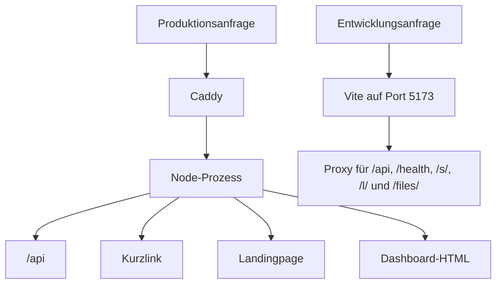

# Backend-Überblick

Ein Node.js-Prozess liefert das Dashboard, die API und öffentliche Weiterleitungen. Der Einstieg ist `apps/api/src/index.ts`. Er lädt die Umgebung, führt Migrationen aus, legt die erste Administratorin oder den ersten Administrator an, wenn keine existiert, löscht abgelaufene Klickereignisse, Reset-Token und Sitzungen und lauscht auf `APP_PORT`.

Dieselbe Bereinigung läuft jede Stunde. `SIGINT` und `SIGTERM` schließen den HTTP-Server und den Datenbankpool.

## Aufbau des Prozesses

`apps/api/src/server.ts` baut die Fastify-App. Die Routen liegen daneben:

- `auth.ts` für Sitzungen, Passwörter und Zwei-Faktor-Authentifizierung
- `links.ts`, `tracking.ts`, `analytics.ts` und `qr.ts` für das Produkt
- `media.ts` für die Mediathek: Uploads mit Typ aus dem Dateiinhalt, Vorschaubilder, Ordner, Verwendung und öffentliche Dateien unter `/files/<id>/<name>`. `media-backfill.ts` verschiebt ältere QR-Mittelbilder beim Start in die Mediathek
- `pages.ts` für Landingpages: Entwürfe, Veröffentlichen, Verbergen, Duplizieren, Vorschauen, Slug-Vorschläge und die Auslieferung öffentlicher Seiten unter dem Seitenpräfix. Blockdefinitionen, Validierung und HTML-Renderer liegen in `packages/shared/src/pages`
- `admin.ts` für Benutzer, Einstellungen, Audit, Exporte und API-Schlüssel
- `ai/chat.ts` für die Assistenz: Aufrufe an den Anbieter bleiben auf dem Server, Chats werden pro Person gespeichert, und Link-, Kampagnen- und Auswertungsformulare werden im Chat ausgefüllt, bevor etwas angelegt wird
- `redirect-domains.ts` für eigene Weiterleitungsdomains und die Zertifikat-Allowlist
- `system.ts` für die Server-Momentaufnahme der Administratorinnen und Administratoren
- `redirect.ts` für Kurzlinks, die nicht unter `/api` liegen. Danach werden Landingpages versucht, dann das Dashboard

PostgreSQL wird über Drizzle in `packages/database` angesprochen. Schemaänderungen laufen über `npm run db:generate` und `npm run db:migrate`. Anfragekörper werden mit Zod-Schemas in `packages/shared` geprüft.

In Produktion liefert derselbe Prozess `apps/web/dist`. Dateien mit Hash liegen unter `/assets/`. Jedes andere `GET` oder `HEAD`, das weder Kurzlink noch Landingpage ist, gibt das Dashboard-`index.html` zurück, wenn der Host die Deployment-Domain ist. Eine verifizierte Weiterleitungsdomain liefert nur Kurzlinks, ihr zugeordnete Landingpages und öffentliche Mediendateien unter `/files/`. Andere Pfade auf diesem Host geben 404 zurück, einschließlich Dashboard und `/api`. `POST` auf einen unbekannten Pfad und jeder unbekannte `/api`-Pfad geben 404 zurück. In der Entwicklung liefert Vite das Dashboard, und dieser Prozess liefert nur die API, den Health-Check, öffentliche Mediendateien, Kurzlinks und Landingpages. Landingpages senden ihre eigene, strengere Content-Security-Policy, beschrieben unter [Weiterleitungen](/docs/developer/backend/redirects). Produktion sendet eine Content-Security-Policy, die `blob:`-Verbindungen erlaubt, damit ein QR-Mittelbild eingebettet werden kann.

## Anfragepfad

Eine Anfrage unter `/api` kann sich mit dem Sitzungscookie authentifizieren (`sharry_session`, wenn `APP_NAME` `Sharry` ist) oder, außerhalb von `/api/auth`, mit `Authorization: Bearer`. Kontorouten lehnen einen Bearer-Token ab, bevor der Handler läuft. Aufrufe mit API-Schlüssel sind auf etwa 120 pro Minute und Schlüssel begrenzt.

Zustandsändernde `/api`-Anfragen mit einem `Origin`-Header müssen zu `APP_URL` oder `SHORT_URL_BASE` passen. `GET`, `HEAD` und `OPTIONS` überspringen diese Prüfung. Außerhalb der Produktion ist ein Origin auf `localhost` oder `127.0.0.1` ebenfalls erlaubt.

`GET /health` führt `select 1` aus und gibt `{ ok: true }` zurück. Es verlangt keine Sitzung. Deploy fragt es nach jedem Neustart ab.

Das Körperlimit ist 1 MB. Hochgeladene Bilder haben ein eigenes Limit von 512 KB und einer Datei.

## Workspaces

| Pfad | Rolle |
| --- | --- |
| `apps/api` | Fastify-API, Weiterleitungen und statische Dateien in Produktion |
| `apps/web` | React-Dashboard |
| `packages/database` | Drizzle-Schema und Migrationen |
| `packages/shared` | Zod-Schemas, Präfix- und Slug-Regeln, Umgebungsparsing, QR-Stil |
| `scripts` | Dev-Server, Migrate, Deploy, Backup, create-admin |
| `deploy` | systemd-Unit und Caddy-Beispiel |

Lokale Entwicklung und das Deployment in Produktion sind auf den nächsten Seiten beschrieben. Eine Route oder eine gemeinsame Vorgabe hinzuzufügen beschreibt [Die API erweitern](/docs/developer/backend/extending).
