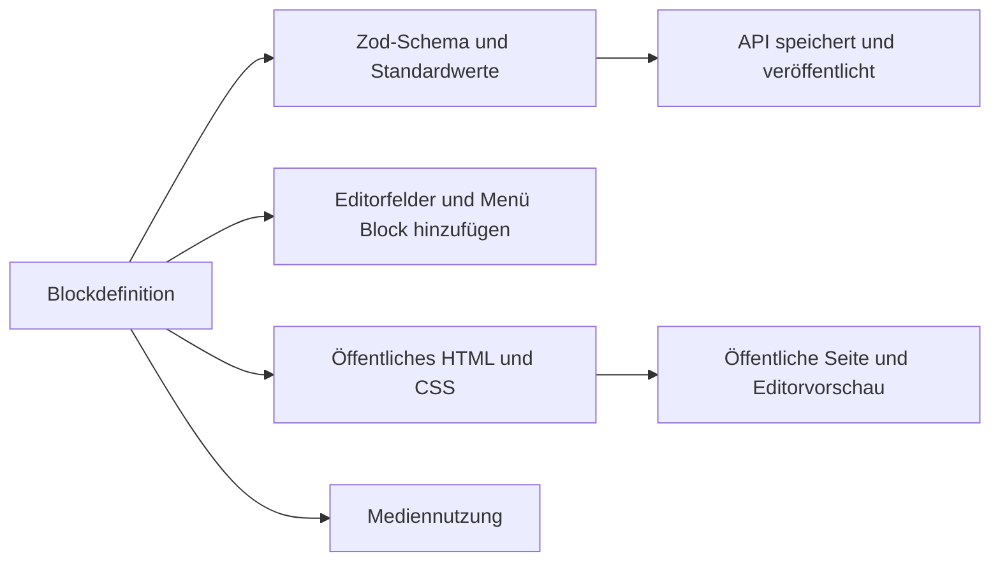

# Blöcke im Seiten-Builder

Jede Komponente im Seiten-Builder ist eine Blockdefinition in `packages/shared/src/pages/blocks`. Die Definition ist die einzige Quelle für alles, was den Block betrifft. In der API und im Editor wird nichts pro Block geschrieben.



- Aus `fields` entstehen das Zod-Schema, mit dem die API prüft (`propsSchema`), die Standardwerte eines neuen Blocks (`defaultProps`) und die Steuerelemente im Editor (`FieldsEditor` in `apps/web/src/components/page-builder/field-editor.tsx`).
- `slots` sind die Bereiche, die andere Blöcke enthalten. Der Blockbaum zeigt sie an, und sie nehmen abgelegte Blöcke und Block hinzufügen an.
- `label`, `description`, `icon` und `group` ordnen den Block im Dialog Block hinzufügen ein. Die Reihenfolge von `pageBlocks` in `registry.ts` ist die Reihenfolge in diesem Dialog.
- `css` und `render` erzeugen das HTML. Die öffentliche Seite, die Vorschau für Angemeldete und die Live-Vorschau im Editor rufen alle dasselbe `renderPage` auf.
- `media`-Felder sammelt `pageMediaIds`. Die Dateien gelten dadurch in der Mediathek als verwendet, und die API prüft, ob die Person sie nutzen darf.

## Aufbau einer Seite

Eine Seite speichert `{ blocks: PageBlock[] }` als JSON in `landing_pages.content` und die veröffentlichte Kopie in `published_content`.

```ts
type PageBlock = {
  id: string // 1 bis 40 Buchstaben, Ziffern, _ oder -, eindeutig in der Seite
  type: string // der type der Definition
  props: Record<string, unknown> // ein Wert pro Feld
  slots?: Record<string, PageBlock[]> // eine Liste pro Slot
}
```

Eine Seite enthält höchstens `PAGE_MAX_BLOCKS` (300) Blöcke und `PAGE_MAX_DEPTH` (4) Ebenen. Einstellungen für die ganze Seite, etwa Titel, Hintergrund, Schrift und Bild beim Teilen, stehen in `pageSettingsSchema` und nicht in einem Block.

## Einen Block hinzufügen

Das Beispiel fügt einen Block Hinweis hinzu: eine kurze hervorgehobene Nachricht.

### 1. Die Definition schreiben

Lege `packages/shared/src/pages/blocks/notice.ts` an:

```ts
import { defineBlock } from '../block.ts'
import { field } from '../fields.ts'
import { escapeHtml } from '../html.ts'
import { color, pick, radius, radiusOptions, styleAttr } from '../style.ts'

export const noticeBlock = defineBlock({
  type: 'notice',
  label: 'Notice',
  description: 'A short highlighted message.',
  icon: 'Info',
  group: 'Content',
  fields: {
    text: field.text({ label: 'Message', max: 300, multiline: true, default: 'Doors open at 9.' }),
    background: field.color({ label: 'Background', default: '#fef3c7' }),
    radius: field.choice({ label: 'Corners', default: 'md', options: radiusOptions }),
  },
  css: '.b-notice{margin:0;padding:12px 16px;white-space:pre-line}',
  render(props) {
    const style = styleAttr({ background: color(props.background), 'border-radius': pick(radius, props.radius, 'md') })
    return `<p class="b-notice"${style}>${escapeHtml(props.text)}</p>`
  },
})
```

`defineBlock` leitet den Typ von `props` aus `fields` ab, deshalb wird `render` gegen die Felder typgeprüft.

- `type` steht in jeder gespeicherten Seite. Nutze Kleinbuchstaben, Ziffern und Bindestriche und benenne ihn nie um, sobald Seiten ihn nutzen.
- `group` ist `Layout`, `Content` oder `Media`.
- Jedes Feld braucht ein `label` und einen `default`. Der Standardwert einer `choice` muss eine ihrer Optionen sein.

Texte in Definitionen bleiben Englisch. Der Editor übersetzt sie mit `t()`.

### 2. Registrieren

Füge `noticeBlock` in `packages/shared/src/pages/registry.ts` zu `pageBlocks` hinzu, an der Stelle, die er im Dialog Block hinzufügen haben soll.

### 3. Ein Symbol vergeben

Das Symbol ist ein Name aus [lucide](https://lucide.dev/icons). Ein neuer Name gehört an zwei Stellen:

1. `blockIconNames` in `packages/shared/src/pages/block.ts`.
2. Die Zuordnung `blockIcons` in `apps/web/src/components/page-builder/block-icons.tsx`, importiert aus `lucide-react`.

Die Zuordnung hat den Typ `Record<BlockIconName, LucideIcon>`, deshalb schlägt `npm run typecheck` fehl, bis beide Listen passen. Ein vorhandenes Symbol wiederzuverwenden braucht keine Änderung.

### 4. Übersetzen

Ergänze in `apps/web/src/i18n/de.ts` einen deutschen Eintrag für jeden Text des Blocks, den es noch nicht gibt: `label`, `description`, Slot-Bezeichnungen, Feldbezeichnungen, `help`-Texte, Bezeichnungen von Auswahloptionen und das `itemLabel` einer Liste. Im Beispiel sind das `Notice`, `A short highlighted message.` und `Message`. `Background`, `Corners` und die Eckenoptionen gibt es schon.

### 5. Tests ausführen

`npm test` führt den Vertrag in `packages/shared/src/pages/blocks.test.ts` für jeden registrierten Block aus. Ein neuer Block wird also getestet, ohne dass du einen Test schreibst:

- Er hat Bezeichnung, Beschreibung, ein bekanntes Symbol und eine Gruppe, jedes Feld hat eine Bezeichnung, und jeder Standardwert einer Auswahl ist eine Option.
- Die Standardwerte bestehen das eigene Schema des Blocks, und ein leeres `props`-Objekt wird mit den Standardwerten gefüllt.
- Ein mit `createBlock` erzeugter Block wird validiert und gerendert.
- Blöcke in jedem Slot erscheinen im HTML.
- Eine feindliche Zeichenkette in jedem Textfeld wird escaped.
- Jede CSS-Klasse beginnt mit `b-`.
- Jeder `type` ist eindeutig und kleingeschrieben.

`apps/web/src/components/page-builder/blocks.test.ts` prüft, dass jeder Block im Editor ein Symbol und für jede Bezeichnung, Beschreibung und Option einen deutschen Text hat.

Für Verhalten, das nur diesen Block betrifft, etwa eine Auswahl, die das Markup ändert, gehört ein Test in `packages/shared/src/pages/page.test.ts`.

Es braucht keine Datenbankmigration, keine API-Route und keine Änderung am Editor. Führe `npm run typecheck` und `npm test` aus und beschreibe den Block danach in `apps/web/docs/<locale>/user/pages.md`.

## Feldarten

Felder entstehen mit den `field`-Helfern in `packages/shared/src/pages/fields.ts`.

| Helfer | Gespeicherter Wert | Prüfung | Steuerelement im Editor |
| --- | --- | --- | --- |
| `field.text({ max, multiline?, placeholder? })` | String | Getrimmt, höchstens `max` Zeichen | Eingabefeld, mit `multiline` ein Textbereich |
| `field.richText()` | HTML-String | Höchstens 20.000 Zeichen, bereinigt mit `cleanRichText` | TipTap-Editor mit Formatierungsleiste |
| `field.url({ shortLinks?, placeholder? })` | String | `isSafeHref`: `http(s)`, `mailto:`, `tel:`, `/pfad`, `#anker` oder leer | Eingabefeld. `shortLinks` schlägt die Kurzlinks der Person vor |
| `field.color()` | `#rrggbb` oder `null` | Sechsstelliges Hex | Farbwähler und Hex-Feld mit Button zum Leeren. `render` muss `null` behandeln |
| `field.choice({ options, default })` | Ein Optionswert | Muss ein gelisteter Wert sein | Auswahl |
| `field.toggle()` | Boolean | Boolean | Schalter |
| `field.media({ accept: 'image' \| 'video' })` | ID aus der Mediathek oder `null` | UUID. Die API prüft, ob die Person die Datei nutzen darf | Medienfeld mit Auswahl aus der Mediathek und Hochladen per Ablegen |
| `field.list({ item, itemLabel, min?, max })` | Array von Eintrags-Props | Zwischen `min` und `max` Einträgen, jeder Eintrag geprüft durch seine Felder | Wiederholte Gruppe mit Hinzufügen, Entfernen und Umsortieren |

Jeder Helfer nimmt `help` an. Text-, URL- und Auswahlfelder zeigen es in einem Info-Tooltip neben der Bezeichnung. Ein Listeneintrag enthält nur einfache Felder, keine weiteren Listen. `style.ts` enthält die gemeinsamen Skalen `spacingOptions`, `radiusOptions`, `fontOptions`, `alignOptions` und `textSizeOptions`, dazu `pick` zum Nachschlagen der CSS-Werte. Nutze sie statt freier Zahlen, damit Seiten einheitlich bleiben.

Eine neue Feldart braucht einen Fall in `fieldSchema` in `fields.ts` und in `FieldControl` in `field-editor.tsx`, dazu Tests in `field-editor.test.tsx` und `page.test.ts`.

## Slots

Ein Block mit `slots: [{ name: 'children', label: 'Content' }]` bekommt das gerenderte HTML jedes Slots im dritten Argument von `render`. Setze es unverändert ein, etwa `${slots.children ?? ''}`. Das HTML ist bereits von den Kindblöcken escaped und gerendert. Die Verschachtelung endet bei `PAGE_MAX_DEPTH`, und der Editor lehnt Ablegen oder Hinzufügen ab, das tiefer ginge.

`container` und `columns` stehen in `layoutBlocks` in `render.ts`. Auf oberster Ebene einer Seite nehmen diese Blöcke die volle Breite ein, andere Blöcke werden in einer zentrierten Spalte mit Seitenrand gruppiert. Ein neuer Abschnittsblock mit voller Breite gehört in diese Menge.

## Regeln fürs Rendern

Öffentliche Seiten werden mit einer Content Security Policy ausgeliefert, die Skripte, Frames, Formulare und fremde Ressourcen sperrt. Halte `render` in diesen Grenzen:

- Escape jeden Textwert mit `escapeHtml`, auch Attributwerte.
- Baue `style`-Attribute mit `styleAttr`. Es überspringt leere Werte und escaped das Ergebnis. Gib Farben durch `color()` und Skalenschlüssel durch `pick()`, denn ein gespeicherter Wert kann aus einer älteren Version des Blocks stammen.
- Gib Rich Text vor der Ausgabe noch einmal durch `cleanRichText`.
- Prüfe Links mit `isSafeHref`, bevor du ein `href` schreibst.
- Löse Medien mit `context.media(id)` auf. Es liefert `null` für eine fehlende oder gelöschte Datei, und der Block rendert dann nichts oder einen Ersatz.
- Schreibe kein `<script>`, keine Inline-Event-Handler und kein `<iframe>`. Interaktive Blöcke nutzen nur HTML, wie das Akkordeon mit `<details>` und `<summary>`. Symbole werden mit CSS gezeichnet, deshalb bietet das Akkordeon einen Pfeil oder ein Plus statt einer Symbolauswahl.
- Schreibe `css` einmal pro Block und beginne jede Klasse mit `b-<type>`. Das CSS wird nur in Seiten eingebettet, die den Block nutzen. Eine Modifikator-Klasse wie `.bordered` darf im selben Selektor auf eine `b-`-Klasse folgen. Der CSS-Test listet die erlaubten Modifikatoren.

## Einen Block später ändern

Gespeicherte Seiten werden mit den aktuellen Definitionen gelesen. Eine Änderung muss also annehmen, was ältere Seiten gespeichert haben:

- Ein neues Feld bekommt in bestehenden Blöcken seinen `default`. Das ist sicher.
- Ein entferntes Feld fällt beim nächsten Speichern der Seite weg. Das ist sicher.
- Entferne keine Auswahloption, die gespeicherte Seiten nutzen könnten. Ihre Entwürfe würden beim Speichern und in der Vorschau für Angemeldete an der Prüfung scheitern. Behalte den alten Wert als Option und bilde ihn in `render` ab, etwa mit `pick` und einem Ersatzwert.
- Benenne keinen Block-`type` um und entferne keinen. Veröffentlichte Seiten überspringen einen unbekannten Block, aber Entwürfe, die ihn enthalten, lassen sich nicht mehr speichern oder als Vorschau öffnen.
