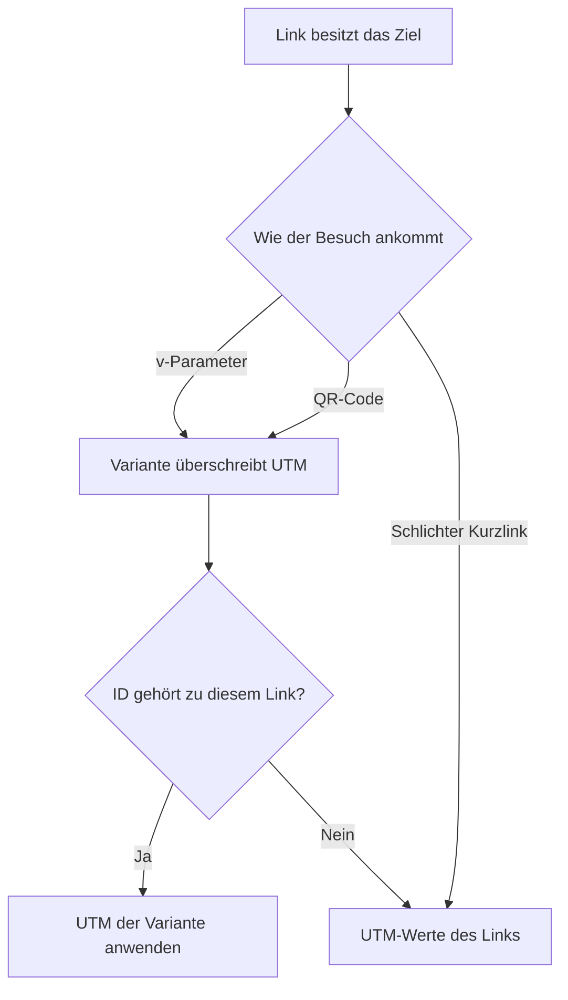

# Kampagnen

Eine Kampagne ist eine benannte Gruppe von Varianten. Sie ändert das Ziel nicht und ist kein A/B-Test. Die Kampagnenliste zeigt, wie viele Varianten jede Kampagne hat. Kampagnenordner sind von Linkordnern getrennt und folgen denselben Zeilen, dem Anlegen und dem Ziehen wie Links. Ein Klick hakt eine Zeile an, ein zweiter Klick öffnet sie. Umschalt-Klick füllt die Zeilen dazwischen, und Befehl-Klick hakt einzelne Zeilen an. Gehakte Zeilen sind hellblau. Löschen, Verschieben nach und das Ziehen einer gehakten Zeile gelten für die ganze Auswahl. Verschieben öffnet den Ordnerbaum in einem Dialog. Neue Kampagne öffnet einen Dialog für Name und Beschreibung. Kampagne anlegen und Abbrechen bleiben in diesem Dialog, die Liste verschiebt sich nicht. Bei einer Kampagne ist die Überschrift der Name, ein größeres Symbol steht mittig daneben. Speichern und Löschen stehen in der nächsten Zeile. Auf einem kleinen Bildschirm wandern diese beiden Schaltflächen in die Leiste unter der oberen Leiste. Kampagnen-Tags sind von Link-Tags getrennt.

## Wofür eine Kampagne da ist

Nutze eine Kampagne, wenn derselbe Kurzlink mit unterschiedlichen UTM-Werten gemessen werden soll. Ein gedrucktes Plakat, eine E-Mail und ein QR-Code können jeweils eine Variante tragen. Slug und Ziel bleiben am Link. Eine spätere Änderung des Ziels aktualisiert jede Variante, weil die Variante kein eigenes Ziel speichert.

Du siehst deine eigenen Kampagnen. Eine Administratorin oder ein Administrator sieht jede Kampagne. Das Löschen einer Kampagne löscht ihre Varianten. Das Löschen des Kurzlinks löscht die Varianten, die auf ihn zeigen.

## Varianten

Eine Variante gehört zu einem Kurzlink und kann dessen UTM-Parameter überschreiben. Leere Felder behalten die Werte des Links. Setze nur die Schlüssel, die abweichen sollen, zum Beispiel `utm_content=poster`, während `utm_source` am Link bleibt.

Die Variante gilt, wenn der Kurzlink mit `?v=<variant id>` geöffnet wird oder ein QR-Code mit dieser Variante gespeichert ist. Eine Varianten-ID von einem anderen Link wird ignoriert. Der Besuch nutzt dann die eigenen UTM-Werte des Links.

Die verfolgte Adresse sieht so aus: `https://share.example.com/s/summer-sale?v=<variant id>`.

Lege zuerst die Kampagne an und füge dann auf ihrer Seite Varianten hinzu. Wenn die KI eingeschaltet ist, entwirft ein Satz wie „newsletter, Instagram, poster“ mehrere Varianten mit Namen und UTM-Werten. Übernehmen kopiert einen Entwurf in das Variantenformular. Diese Varianten hinzufügen speichert die übrigen Entwürfe auf dem Link, der in diesem Formular gewählt ist. Ist die Beschreibung leer, füllt dieselbe Antwort sie, und Kampagne speichern speichert diesen Text. Jede Variante hat einen Namen, einen Link und die UTM-Überschreibungen. Die Varianten stehen in einer Tabelle mit Name, Kurz-URL, UTM-Werten und Symbolschaltflächen zum Bearbeiten, Kopieren oder Löschen. Der Link-Editor kann eine gespeicherte Variante auch an einen QR-Code hängen. Die QR-Vorschau nutzt die UTM-Werte dieser Variante, bevor du den Code speicherst.
