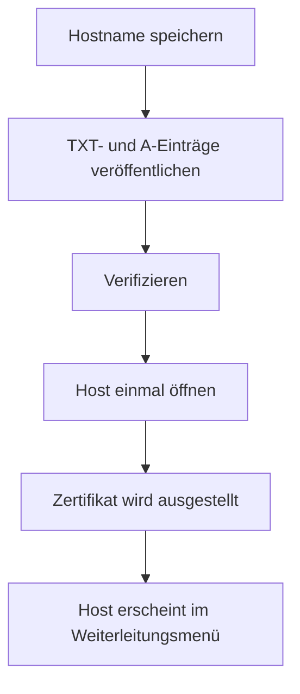

# Domains

Domains steht Administratorinnen und Administratoren zur Verfügung. Eine Weiterleitungsdomain ist ein Hostname, den Personen wählen können, wenn sie einen Link anlegen oder bearbeiten, damit die Kurz-URL diesen Host statt der Deployment-Domain nutzt. Die Deployment-Domain bleibt die Vorgabe und wird hier nicht hinzugefügt.

## Eine Domain hinzufügen

Gib einen Hostnamen wie `go.brand.com` ein. Der Name hat kein Schema, keinen Port und keinen Pfad. Das Speichern öffnet einen Dialog mit den zwei DNS-Einträgen.

1. Füge einen TXT-Eintrag hinzu. Der Dialog zeigt den Namen und den Token. Der Name ist `_<slug>-challenge.go.brand.com`, und der Slug kommt aus `APP_NAME`. Die Vorgabe `Sharry` nutzt `_sharry-challenge.go.brand.com`. Kopieren steht neben jedem Wert.
2. Füge einen A-Eintrag für diesen Hostnamen hinzu, der auf die IPv4-Adresse im Dialog zeigt. Diese Adresse ist die öffentliche IPv4-Adresse dieses Servers. Kopieren steht neben der Adresse.

Wenn dieser Server keine öffentliche IPv4-Adresse hat, sagt der Dialog, dass die Adresse nicht nachgeschlagen werden konnte.

Prüfen kontrolliert den TXT-Eintrag. Veröffentliche beide Einträge und klicke dann in der Zeile auf Prüfen. Nach der Verifizierung öffne `https://go.brand.com` einmal, damit das Zertifikat ausgestellt werden kann. Der erste Besuch kann langsam sein, während das Zertifikat angefordert wird. Sharry prüft den TXT-Eintrag jede Stunde erneut. Ein vorübergehender Lookup-Fehler lässt die Domain verifiziert. Zwei Prüfungen hintereinander ohne passenden Eintrag setzen sie auf ausstehend zurück.

Eine ausstehende Zeile kann denselben Dialog mit Einrichtung wieder öffnen. Ein vergebener Hostname antwortet: "That domain is already added."

## Nach der Verifizierung

Jede angemeldete Person sieht verifizierte Domains im Menü für die Weiterleitungsdomain bei Neuer Link und im Link-Editor. Ausstehende Domains bleiben aus diesem Menü.

Löschen entfernt die Domain. Links, die sie genutzt haben, zeigen beim nächsten Lesen die Deployment-Domain. Ein schon ausgestelltes Zertifikat funktioniert weiter, bis es abläuft. Gedruckte QR-Codes behalten den Host, mit dem sie erstellt wurden.
