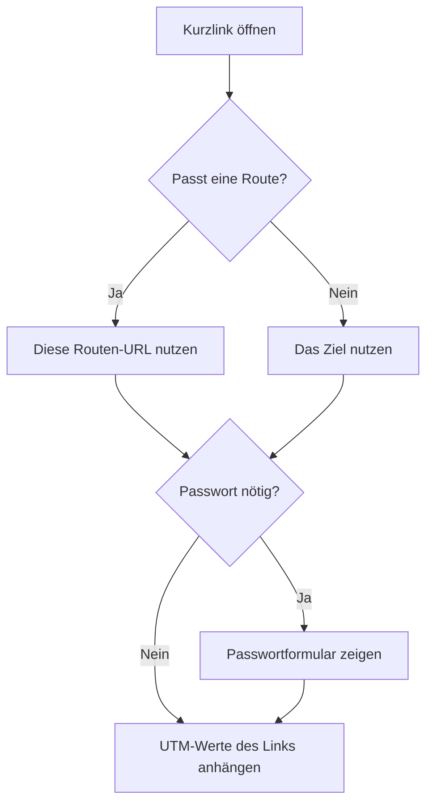

# Links

Ein Kurzlink behält seinen Slug, wenn du das Ziel änderst. Gedruckte QR-Codes und gespeicherte Adressen funktionieren weiter. Slugs sind unabhängig von der Großschreibung eindeutig. Ein vergebener Slug antwortet: "This short URL is already in use. Please choose a different slug."

## Die öffentliche Adresse

Der öffentliche Pfad nutzt das Präfix aus den Einstellungen, zum Beispiel `https://share.example.com/s/summer-sale`. Eine Änderung des Präfixes aktualisiert jeden angezeigten Link. Schalte alte Präfixe ein, damit der bisherige Pfad weiter aufgelöst wird. Diese Änderung verlangt eine Bestätigung.

Die Domain in dieser Adresse kommt vom Deployment-Ursprung, außer der Link speichert eine verifizierte Weiterleitungsdomain. Neuer Link und der Link-Editor bieten diese Wahl. Die Deployment-Domain bleibt die Vorgabe. Eine später entfernte Domain fällt aus der Kurz-URL, dem CSV-Export und neuen QR-Codes. Ein schon heruntergeladenes QR-Bild behält die Adresse, die damals kodiert wurde. Derselbe Slug öffnet weiter auf dem Deployment-Host.

Das Präfix ist ein einzelnes Pfadsegment. Es muss mit `/` beginnen und darf nur Kleinbuchstaben, Ziffern und Bindestriche enthalten. Es darf kein Dashboard-Pfad wie `api`, `docs`, `login` oder `links` sein. Ein Slug hat 2 bis 64 Zeichen aus Buchstaben, Ziffern und Bindestrichen und darf kein reservierter Name wie `favicon.ico` oder `robots.txt` sein.

Lass den Slug leer, um einen zu erzeugen. Die Länge kommt aus den Einstellungen und liegt zwischen 4 und 16 Zeichen. Die Vorgabe ist 5. Das Alphabet lässt Zeichen weg, die leicht zu verwechseln sind.

## Die Linkliste

Die Linkseite lädt 50 auf einmal. Mehr laden zeigt den Rest. Die Suche trifft Slug, Titel oder Ziel. Jede Zeile zeigt die Klickzahl. Text, der länger als die Zelle ist, endet mit einer Auslassung. Auf einem schmalen Bildschirm scrollt die Tabelle seitlich, damit die Spalten lesbar bleiben. Der Status ist Aktiv oder Pausiert. Das Test-Symbol öffnet die Kurz-URL in einem neuen Tab.

Du siehst deine eigenen Links. Eine Administratorin oder ein Administrator sieht und bearbeitet jeden Link. Die Einstellungen können Benutzer die Links der anderen sehen lassen, sie nur ansehen oder bearbeiten, und optional Admin-Links sehen oder ändern. Enthält die Liste einen Link, den du ansehen aber nicht ändern kannst, ist jede Zeile mit Bearbeitbar oder Nur ansehen markiert. Der Titel eines solchen Links ist blasser als der eines bearbeitbaren Links. Ein Link, den du öffnen kannst, zeigt, wer ihn erstellt hat und wer ihn zuletzt geändert hat. Die Linkliste ergänzt Erstellt von, wenn sie den Link einer anderen Person enthalten kann. Zuletzt geändert von ist Unbekannt, wenn Sharry nicht weiß, wer gespeichert hat.

## Anlegen und bearbeiten

Ein neuer Link braucht ein `http`- oder `https`-Ziel, höchstens 4096 Zeichen. Titel und Beschreibung sind optional. Wähle einen Weiterleitungstyp oder lass die Kontovorgabe aus den Einstellungen. Eine neue Installation nutzt 302. Die anderen Möglichkeiten sind 301, 307 und 308.

Wenn die KI in den Einstellungen eingeschaltet ist, zeigen die Felder für Slug und Titel bei einem neuen und bei einem gespeicherten Link je einen Knopf. Er liest die Zielseite und schlägt einen freien Slug oder den Seitentitel vor, sobald das Ziel eine gültige URL ist. Ein vorgeschlagener Slug besteht aus den ersten drei Wörtern dieses Titels, oder aus der Adresse, wenn der Titel keinen Slug ergibt. Ein Tooltip am Feld sagt, woher der Vorschlag kommt. Kann Sharry keinen Slug vorschlagen, bleibt diese Meldung im selben Tooltip. Beides kannst du ändern. Gespeichert wird erst, wenn du den Link speicherst. Die Knöpfe bleiben verborgen, solange die KI aus ist.

Derselbe Schalter zeigt UTM vorschlagen über den UTM-Feldern bei einem neuen Link, einem gespeicherten Link und im Kurzlink-Formular im Chat. Eine optionale Zeile sagt, wo du den Link teilst, zum Beispiel „October newsletter“ oder „Instagram bio“. UTM vorschlagen füllt Quelle, Medium und Kampagne. Die übrigen UTM-Felder bleiben, wie sie sind. Gespeichert wird erst, wenn du speicherst.

In der Linkliste öffnet Mehrere hinzufügen einen Dialog. Die Liste darunter bleibt an ihrem Platz. Der Dialog nimmt bis zu 20 Ziel-URLs an, eine pro Zeile. Prüfen zeigt einen Titel und einen freien Slug für jede Seite. Ein fehlender Titel oder ein Titel, der nur der Seitenname ist, wird neu formuliert. Nimm das Häkchen von einer Zeile, um sie auszulassen. Links anlegen speichert die Zeilen, die du behältst, schließt den Dialog und leert ihn. Schließen ohne Anlegen leert ihn ebenfalls.

Das Ablaufdatum wird in deiner lokalen Zeit eingegeben und in UTC gespeichert. Ein leeres Ablaufdatum läuft nie ab. Ein abgelaufener Link leitet nicht mehr weiter.

Pausieren setzt den Status auf deaktiviert. Ein pausierter Link leitet nicht weiter. Schalte ihn zurück auf Aktiv, um denselben Slug und die Klickhistorie wiederherzustellen.

Ein Link kann ein Passwort verlangen, bevor er weiterleitet. Besucher müssen dieses Passwort eingeben, bevor der Kurzlink weiterleitet. Das Passwort wird als Hash gespeichert. Lass das Feld bei einer späteren Bearbeitung leer, um das gespeicherte Passwort zu behalten. Leeren entfernt die Pflicht.

Link speichern steht in der Seitenkopfzeile und noch einmal am Ende des Formulars. Beide Schaltflächen speichern Ziel, Slug, Titel, Beschreibung, Weiterleitungsdomain, Weiterleitungstyp, Ablauf, Passwort, UTM-Felder und Routen zusammen. Der QR-Code hat sein eigenes Speichern.

## Routen

Routen sind optional. Lass die Liste leer, dann nutzt jeder Besuch das Ziel.

Wenn die KI eingeschaltet ist, nimmt eine Zeile über den Routen einen Satz an, zum Beispiel „iPhone visitors go to https://apps.example.com, Germany goes to https://example.com/de“. Routen entwerfen hängt diese Regeln an die Liste. Du kannst sie ändern oder entfernen. Gespeichert werden sie erst, wenn du den Link speicherst.

Füge eine Route hinzu, um manche Besuche an eine andere `http`- oder `https`-URL zu schicken. Jede Route kann so viele Bedingungen haben, wie du brauchst, und jede Bedingung dieser Route muss passen. Routen laufen von oben nach unten. Die erste passende Route wird verwendet. Schiebe eine Route nach oben oder unten, um die Reihenfolge zu ändern. Eine Route kann einen Namen haben. Lass ihn leer, dann wird die Route als Route 1, Route 2 und so weiter angezeigt.

Wähle einen oder mehrere Werte aus der Liste: Browser, Gerät, Betriebssystem, Land, Verweis und UTM-Quelle, Medium, Kampagne, ID, Begriff und Inhalt. **is** passt, wenn der Besuch einem der gewählten Werte entspricht. **is not** passt, wenn er keinem davon entspricht. Die Suche grenzt die Liste ein. Kampagne, ID, Begriff und Inhalt bieten zusätzlich Werte, die schon am Link, an seinen Varianten oder an seinen Klicks gespeichert sind. Verweis und jedes UTM-Feld können mehrere eigene Werte neben den Vorgaben enthalten. Ein eigener Verweis trifft diesen Host und seine Subdomains, so wie Google `news.google.com` trifft. Länder brauchen die Geo-Datenbank; ohne sie wird eine Länder-Route übersprungen.

UTM-Bedingungen lesen die Query-Zeichenfolge am Kurzlink, zum Beispiel `?utm_source=newsletter`. Die am Link gespeicherten UTM-Werte werden trotzdem an die gewählte URL gehängt.

Wenn nichts passt, ein gespeicherter Wert nicht mehr erkannt wird, die Routen-URL ungültig ist oder das Land nicht ermittelt werden kann, wird diese Route übersprungen. Besucher nutzen dann eine spätere passende Route oder das Ziel. Die Linkseite behält einen veralteten Wert und sagt, dass Besucher das Ziel nutzen, bis du die Route aktualisierst. Die Weiterleitung selbst gelingt weiter.

## Weiterleitungen

Sharry sendet bei jeder Weiterleitung `Cache-Control: no-store`, damit eine spätere Zieländerung beim nächsten Öffnen der Kurz-URL gilt. Das gilt auch für 301 und 308.

Ein richtiges Passwort geht mit 303 weiter. Der Browser fordert das Ziel dann mit GET an. Dieses Freischalten zählt als Klick. Spätere Besuche nutzen den Weiterleitungstyp des Links und ein Freischalt-Cookie, deshalb erscheint das Passwortformular in diesem Browser nicht wieder, bis das Cookie weg ist.

## UTM-Parameter

Jeder Link kann `utm_source`, `utm_medium`, `utm_campaign`, `utm_id`, `utm_term` und `utm_content` speichern. Diese Werte werden beim Weiterleiten an das Ziel gehängt. Vorhandene, nicht betroffene Query-Parameter und das URL-Fragment bleiben.

Ein leeres Feld fügt für diesen Schlüssel nichts hinzu. Wenn das Ziel denselben UTM-Schlüssel schon hat, warnt das Speichern, dass der gespeicherte Wert ihn ersetzt: "Saving will replace … already present on the destination." Die verfolgte URL unter dem Formular ist das Ziel mit den aktuellen UTM-Werten, damit du das Ergebnis vor dem Speichern prüfen kannst.

Eine Kampagnenvariante oder ein QR-Code kann diese Werte für einen Besuch überschreiben. Siehe Kampagnen und QR-Codes.
