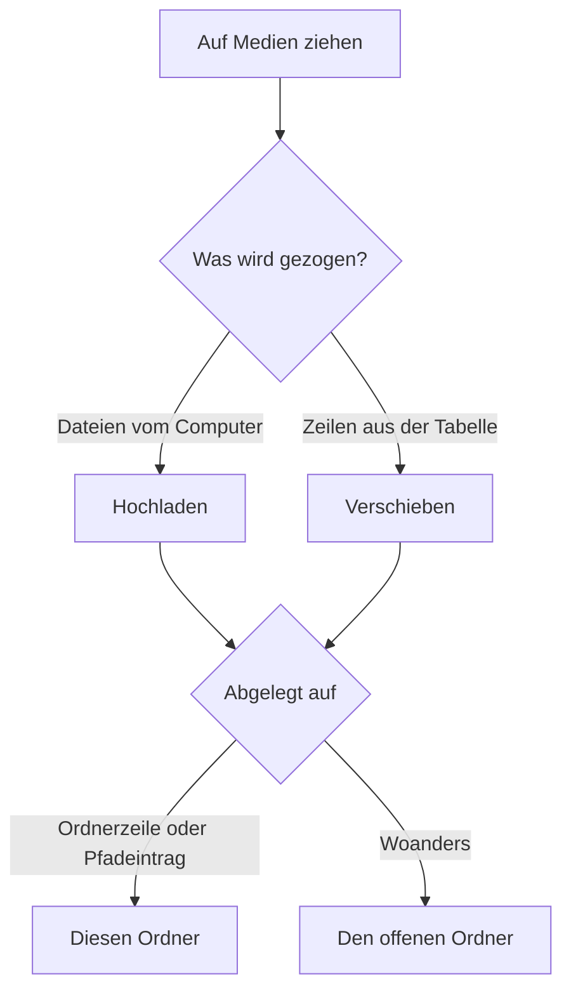

# Medien

Die Mediathek enthält die Dateien, die die App nutzt, etwa Mittelbilder von QR-Codes. Nur Kontofotos liegen außerhalb. Öffne Medien in der Seitenleiste. Dateien und Ordner teilen sich eine Tabelle mit denselben Zeilen, derselben Auswahl, Sortierung, Filtern und Spalteneinstellungen wie Links und Kampagnen.

## Hochladen per Ziehen

Ziehe Dateien von deinem Computer irgendwo auf die Medienseite. Ein Rahmen zeigt, welcher Ordner sie bekommt. Lege sie auf einer Ordnerzeile oder auf einem Ordnernamen im Pfad über der Tabelle ab, um direkt in diesen Ordner hochzuladen. Hochladen und Dateien wählen öffnen stattdessen den Dateidialog.

Jede Datei erscheint beim Hochladen als Zeile mit Fortschrittsbalken, höchstens drei gleichzeitig. Eine abgelehnte Datei bleibt mit dem Grund als Zeile stehen, bis du sie schließt. Erlaubt sind JPEG, PNG, WebP, GIF, SVG, MP4, WebM und PDF. Der Typ wird aus dem Dateiinhalt gelesen, nicht aus dem Namen. Die Größengrenze ist `MEDIA_MAX_UPLOAD_MB`, standardmäßig 25 MB.

Eine SVG mit Skripten, Event-Handlern, eingebettetem HTML oder Verweisen auf andere Dateien wird abgelehnt. Exportiere sie ohne diese Teile erneut oder wandle sie in PNG um.

Ein Name, den es im Ordner schon gibt, bekommt eine Nummer, etwa `photo (2).jpg`.

## Ordnen

Ziehe eine Dateizeile auf eine Ordnerzeile, um sie hineinzuschieben. Ziehe sie auf einen Namen im Pfad, um sie herauszuholen. Sind mehrere Zeilen ausgewählt, verschiebt das Ziehen einer davon die ganze Auswahl. Ein Hinweis bestätigt das Verschieben und bietet einige Sekunden lang Rückgängig an. Verschieben nach öffnet den Ordnerbaum in einem Dialog. Ordner erstellen legt einen Ordner an, den du direkt benennst. Beim Löschen eines Ordners wandern seine Dateien und Unterordner eine Ebene nach oben.

Die Suche in der Tabelle filtert nach Namen. Die Suche in der oberen Leiste findet Dateien in allen Ordnern nach Name, Alternativtext oder Titel und öffnet die Datei.

## Dateidetails

Wähle eine Zeile, um die Datei rechts zu öffnen. Du kannst sie umbenennen, Alternativtext und Titel schreiben, die öffentliche URL kopieren und sehen, welche QR-Codes sie nutzen. Die Dateiendung ändert sich beim Umbenennen nie. Der Alternativtext beschreibt das Bild für Menschen, die es nicht sehen können. Der Filter Alternativtext listet Bilder, denen er noch fehlt.

Eine verwendete Datei kann nicht gelöscht werden. Entferne sie zuerst aus den QR-Codes unter Verwendet von.

## Öffentliche URLs und Datenschutz

Jede Datei hat eine öffentliche Adresse der Form `https://share.example.com/files/<id>/<name>`. Jede Person mit der Adresse kann sie öffnen, auch auf einer verifizierten Weiterleitungsdomain. Lade deshalb keine privaten Dokumente hoch. Die zufällige ID macht die Adresse schwer zu erraten. Videos lassen sich spulen.

Wer welche Dateien sieht, folgt den Einstellungen zum Teilen von Links in den [Einstellungen](/docs/user/settings). Du siehst deine eigenen Dateien. Ein Administrator sieht jede Datei. „Benutzer sehen die Links der anderen“ zeigt auch die Dateien anderer, und „Benutzer können die Links der anderen bearbeiten“ erlaubt Änderungen daran. Eine Datei, die du sehen, aber nicht ändern kannst, erscheint gedämpft und hat keine Aktionen zum Verschieben oder Löschen.

## QR-Codes

Das Feld Mittelbild im QR-Code-Editor nutzt die Mediathek. Aus der Mediathek wählen öffnet eine Auswahl mit Ordnern und Suche. Eine Datei, die du auf das Feld oder in die Auswahl ziehst, wird in die Mediathek hochgeladen und ausgewählt. Nur PNG, JPEG und WebP können Mittelbild sein. Siehe [QR-Codes](/docs/user/qr-codes).
