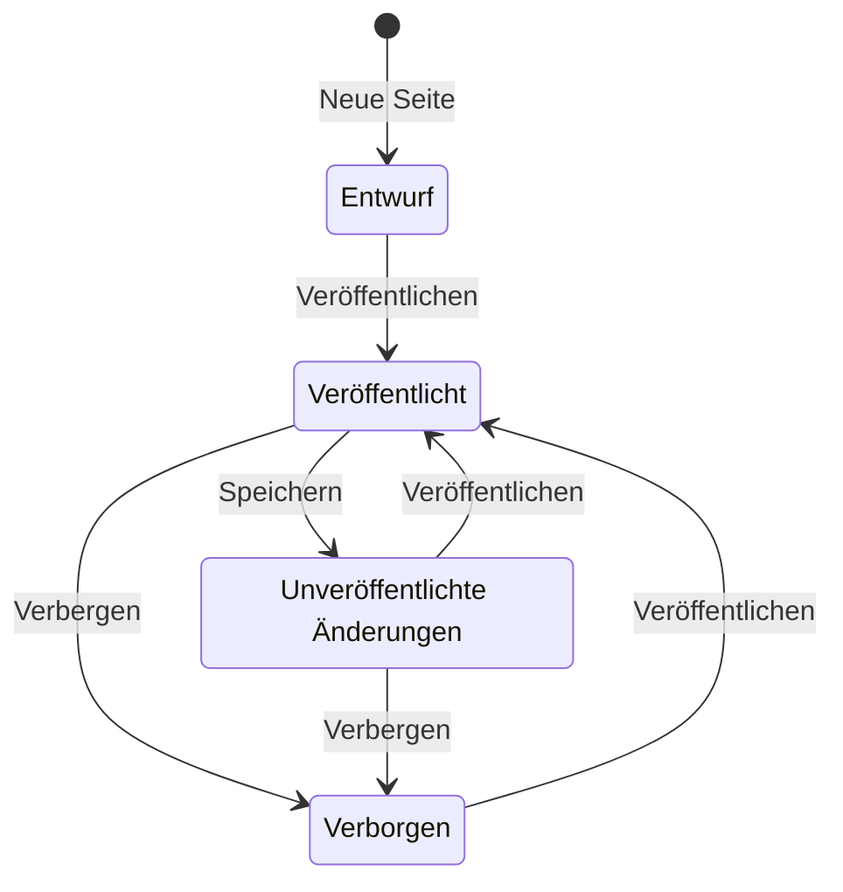

# Seiten

Seiten sind Landingpages, die du aus Blöcken baust, etwa aus Überschriften, Text, Buttons, Bildern und Akkordeons. Öffne Seiten in der Seitenleiste. Seiten und Ordner teilen sich eine Tabelle mit denselben Zeilen, derselben Auswahl, Sortierung, Filtern, Spalteneinstellungen und demselben Ziehen und Ablegen wie Links und Medien.

Eine Seite ist unter `https://share.example.com/l/<slug>` öffentlich. Ein Administrator kann das Präfix `/l` in den [Einstellungen](/docs/user/settings) ändern. Kurzlinks und Seiten nutzen immer unterschiedliche Präfixe.

## Seite erstellen

Wähle Neue Seite, gib einen Titel ein und behalte oder ändere den vorgeschlagenen Slug. Der vorgeschlagene Slug entsteht aus den ersten drei Wörtern des Titels, aus `Winter market` wird zum Beispiel `winter-market`, und bekommt `-2`, wenn er schon vergeben ist. Lass ihn leer für einen zufälligen Slug. Für Slugs gelten dieselben Regeln wie bei Kurzlinks: 2 bis 64 Buchstaben, Ziffern und Bindestriche. Zwei Seiten können sich keinen Slug teilen, egal in welcher Schreibweise.

Eine neue Seite ist zuerst verborgen und enthält einen Abschnitt mit dem Titel, einem Satz und einem Button. Niemand außerhalb der App kann sie sehen, bis du sie veröffentlichst. Eine Seite, die in einem geöffneten Ordner erstellt wird, landet in diesem Ordner.

## Der Editor

Links im Editor stehen die Blockliste und die Einstellungen des gewählten Blocks, rechts eine Live-Vorschau. Auf einem schmalen Bildschirm rutscht die Vorschau nach unten.

- **Blöcke** listet die Seite von oben nach unten. Blöcke, die andere Blöcke enthalten, etwa Container und Zwei Spalten, zeigen ihren Inhalt eingerückt darunter.
- Wähle einen Block, um ihn zu bearbeiten. Seine Felder erscheinen unter der Liste.
- **Block hinzufügen** am Ende der Liste fügt zur Seite hinzu. Der Button in einem Container oder einer Spalte fügt in diesen Bereich ein.
- Ziehe einen Block an seinem Griff auf einen anderen Block, um ihn davor einzusetzen, oder auf einen Button Block hinzufügen, um ihn ans Ende dieses Bereichs zu setzen. Nach oben und Nach unten machen dasselbe per Tastatur oder Maus.
- Duplizieren kopiert einen Block mit allem, was er enthält. Löschen entfernt ihn.
- Die Vorschau wechselt zwischen Desktop- und Handybreite. Sie wird vom selben Code gezeichnet wie die öffentliche Seite, Besucher sehen also genau das. Links in der Vorschau öffnen sich nicht.

Eine Seite kann bis zu 300 Blöcke enthalten, höchstens 4 Ebenen tief verschachtelt. Ein Verschieben oder Hinzufügen, das diese Grenzen sprengen würde, wird mit einer Meldung abgelehnt.

### Blöcke

| Block | Wofür | Wichtige Einstellungen |
| --- | --- | --- |
| Container | Ein Abschnitt, der andere Blöcke gruppiert | Inhaltsbreite, Mindesthöhe, vertikale Position, horizontale Ausrichtung, Abstand oben und unten, Abstand an den Seiten, Außenabstand, Ecken, Hintergrund, Textfarbe, Rahmen, Schatten, Hintergrundbild mit Überlagerung, Anker |
| Zwei Spalten | Zwei Bereiche nebeneinander. Auf dem Handy stehen sie untereinander | Spaltenbreiten, Zwischenraum, vertikale Ausrichtung, Innenabstand, Hintergrund, Textfarbe |
| Überschrift | Ein Titel. Nutze eine Überschrift 1 pro Seite | Ebene 1 bis 3, Ausrichtung, Schrift, Farbe |
| Text | Formatierter Text | Fett, kursiv, unterstrichen, durchgestrichen, Zwischenüberschriften, Listen, Zitate, Links, Textausrichtung, Größe, Schrift, Farbe |
| Button | Ein Aufruf zum Handeln | Beschriftung, Link, Tooltip, neuer Tab, gefüllt oder Umriss, Farben, Ecken, Größe, Schrift, Breite, Innenabstand, Ausrichtung |
| Button-Gruppe | Bis zu vier Buttons nebeneinander, etwa ein Haupt- und ein zweiter Aufruf zum Handeln | Pro Button: Beschriftung, Link, gefüllt oder Umriss, neuer Tab. Für die Gruppe: Farben, Ecken, Textgröße, Zwischenraum, Ausrichtung, auf Handys untereinander |
| Feature-Raster | Bis zu 12 Karten in zwei, drei oder vier Spalten. Handys zeigen eine Spalte | Pro Karte: Bild, Titel, formatierter Text. Für das Raster: Spalten, kleines Symbol oder Bild in voller Breite, schlichte, umrandete oder gefüllte Karten, Kartenfarbe, Ecken, Zwischenraum, Ausrichtung |
| Bild | Ein Bild aus der Mediathek | Alternativtext, Bildunterschrift, Link, Breite, Ausrichtung, Ecken, Rahmen, Abstand, Filter |
| Video | Ein MP4- oder WebM-Video aus der Mediathek | Vorschaubild, Steuerelemente, stumm in Schleife abspielen, Ecken |
| Bildergalerie | Bis zu 24 Bilder aus der Mediathek in einem Raster. Handys zeigen zwei Spalten | Pro Bild: Datei, Alternativtext, Bildunterschrift. Für die Galerie: Spalten, Form (Original, quadratisch, 4:3, 16:9), Zwischenraum, Ecken, Bildunterschriften zeigen, ganzes Bild beim Klick öffnen |
| Akkordeon | Fragen oder Abschnitte, die sich beim Anklicken öffnen | Einträge mit Überschrift und formatierter Antwort, Pfeil oder Plus, ersten Eintrag öffnen, Ecken, Farben, Linien |
| Zitat | Ein Zitat oder eine Kundenstimme | Quelle, schlichter Stil, Linie an der Seite oder groß, Ausrichtung, Schrift, Farbe |
| Abstand | Leerer Raum zwischen Blöcken | Höhe |
| Trennlinie | Eine waagerechte Linie | Durchgezogen, gestrichelt oder gepunktet, Breite, Abstand rundherum, Farbe |

Das Feld Link eines Buttons schlägt beim Tippen deine Kurzlinks vor, damit ein Button Besucher über einen getrackten Kurzlink schicken kann. Ein Link darf eine Webadresse, `mailto:`, `tel:`, ein Pfad mit `/` am Anfang oder ein Anker wie `#preise` sein. Andere Adressen werden abgelehnt.

Die Textformatierung ist auf das beschränkt, was die öffentliche Seite sicher zeigen kann. Eingefügter Inhalt behält Fett, Kursiv, Unterstrichen, Durchgestrichen, Inline-Code, Links, Listen, Zwischenüberschriften, Zitate und Textausrichtung. Alles andere, etwa Farben, Schriften und eingebettete Inhalte, wird entfernt.

Der Alternativtext eines Bildes kommt aus der Mediathek. Fülle Alternativtext im Block aus, um auf dieser Seite einen anderen Text zu nutzen. Eine Datei, die du in einem Bild-, Video-, Bildergalerie- oder Feature-Raster-Block oder als Container-Hintergrund wählst oder ablegst, landet in der Mediathek. Siehe [Medien](/docs/user/media).

Die Mindesthöhe eines Containers macht einen Abschnitt höher als seinen Inhalt, bis zum ganzen Bildschirm für einen Hero-Abschnitt. Die vertikale Position setzt den Inhalt dann oben, mittig oder unten hin oder verteilt die Blöcke. Die horizontale Ausrichtung lässt Blöcke die volle Breite nutzen (Strecken) oder ihre eigene Breite links, mittig oder rechts behalten.

Ein Hintergrundbild füllt den ganzen Abschnitt und wird passend beschnitten. Die Überlagerung legt eine Farbe darüber, leicht, mittel oder stark, damit Text darauf lesbar bleibt. Stelle die Textfarbe des Containers passend ein.

Der Anker gibt einem Container einen Namen, etwa `preise`. Ein Button oder Link mit der Adresse `#preise` springt dann zu diesem Abschnitt. Der Name wird kleingeschrieben und nur mit Buchstaben, Ziffern und Bindestrichen gespeichert. Nutze jeden Namen nur einmal pro Seite.

Akkordeons öffnen und schließen ohne JavaScript. Jeder Eintrag hat eine Überschrift und eine formatierte Antwort, das Symbol ist ein Pfeil oder ein Plus.

## Speichern und veröffentlichen

**Speichern** sichert den Entwurf. Besucher sehen weiter die zuletzt veröffentlichte Fassung. **Veröffentlichen** speichert den Entwurf und macht ihn in einem Schritt zur öffentlichen Seite. Cmd+S oder Strg+S speichert. Solange Änderungen nicht gespeichert sind, steht neben dem Titel Nicht gespeichert. Wer den Editor verlässt oder den Tab schließt, während Änderungen offen sind, wird vorher gefragt.

| Status | Bedeutung |
| --- | --- |
| Entwurf | Nie veröffentlicht. Besucher sehen „nicht gefunden“. |
| Veröffentlicht | Besucher sehen genau die gespeicherte Fassung. |
| Unveröffentlichte Änderungen | Besucher sehen die zuletzt veröffentlichte Fassung. Der gespeicherte Entwurf weicht davon ab. |
| Verborgen | Besucher sehen „nicht gefunden“. Die veröffentlichte Fassung bleibt für das nächste Veröffentlichen erhalten. |

**Vor Besuchern verbergen** in der Kopfzeile des Editors nimmt eine veröffentlichte Seite sofort offline. Derselbe Schalter in den Seiteneinstellungen wird beim nächsten Speichern übernommen. Veröffentlichen schaltet ihn immer aus.

## Vorschau einer nicht öffentlichen Seite

Solange du angemeldet bist, zeigt die Seitenadresse den gespeicherten Entwurf einer Seite, die Entwurf, verborgen oder unveröffentlicht geändert ist, mit der Leiste „Preview, not public“ oben. Andere Besucher sehen „nicht gefunden“. Der Button Vorschau öffnet dieselbe Entwurfsansicht. Sie zeigt die zuletzt gespeicherte Fassung, speichere also zuerst, um deine neuesten Änderungen zu sehen. Die Vorschau wird nie zwischengespeichert oder von Suchmaschinen indexiert. Auf einer Weiterleitungsdomain wird nur die veröffentlichte Fassung ausgeliefert.

## Seiteneinstellungen

Einstellungen in der Kopfzeile des Editors öffnet die Seiteneinstellungen. Sie werden zusammen mit den Blöcken gespeichert und veröffentlicht.

- **Titel** ist der Titel im Browser-Tab. **Slug** ändert die Adresse. Ändert sich der Slug einer veröffentlichten Seite, funktioniert die alte Adresse nicht mehr.
- **Ordner** und **Weiterleitungsdomain** funktionieren wie bei Links. Eine Seite mit Weiterleitungsdomain wird auf dieser Domain und unter der Hauptadresse ausgeliefert, auf keiner anderen Weiterleitungsdomain.
- **Vor Besuchern verbergen** ist oben beschrieben.
- **Suchmaschinen**: Die Beschreibung erscheint in Suchergebnissen. Vor Suchmaschinen verbergen setzt `noindex, nofollow`. Sprache legt die Sprache der Seite fest, etwa `en` oder `de-AT`.
- **Teilen in sozialen Netzwerken**: Titel, Beschreibung und Bild beim Teilen erscheinen, wenn die Adresse in Chats und sozialen Netzwerken gepostet wird. Leere Felder nutzen Titel und Beschreibung.
- **Aussehen**: Hintergrund, Textfarbe und Seitenschrift. Blöcke mit der Schrift Seitenschrift nutzen sie.

## Finden, ordnen und teilen

Die Tabelle zeigt jede Seite mit Status, Adresse, Eigentümer und letzter Änderung. Filtere nach Titel oder Status und sortiere nach Titel, Adresse oder letzter Änderung. URL kopieren kopiert die öffentliche Adresse. Live ansehen öffnet sie, sobald die Seite veröffentlicht ist. Ziehe Seiten auf Ordner oder nutze Verschieben nach. Beim Löschen eines Ordners wandern seine Seiten eine Ebene nach oben. Die Suche in der oberen Leiste findet Seiten nach Titel, Slug oder Beschreibung.

Wer welche Seiten sieht und ändert, folgt den Einstellungen zum Teilen von Links in den [Einstellungen](/docs/user/settings), genau wie bei Links und Medien. Eine Seite, die du sehen, aber nicht ändern kannst, öffnet sich schreibgeschützt. Duplizieren erstellt eine verborgene Kopie der zuletzt gespeicherten Fassung, die dir gehört.

Nach dem Löschen liefert die Adresse einer Seite sofort „nicht gefunden“. Das lässt sich nicht rückgängig machen.

## Sicherheit

Öffentliche Seiten führen nie Skripte aus. Sie laden Bilder und Videos nur aus dieser App und nutzen eine strenge Content Security Policy. Text und Einstellungen werden auf dem Server geprüft, deshalb kann eine Seite auch über die API keine Skripte, Frames oder Formulare bekommen.
