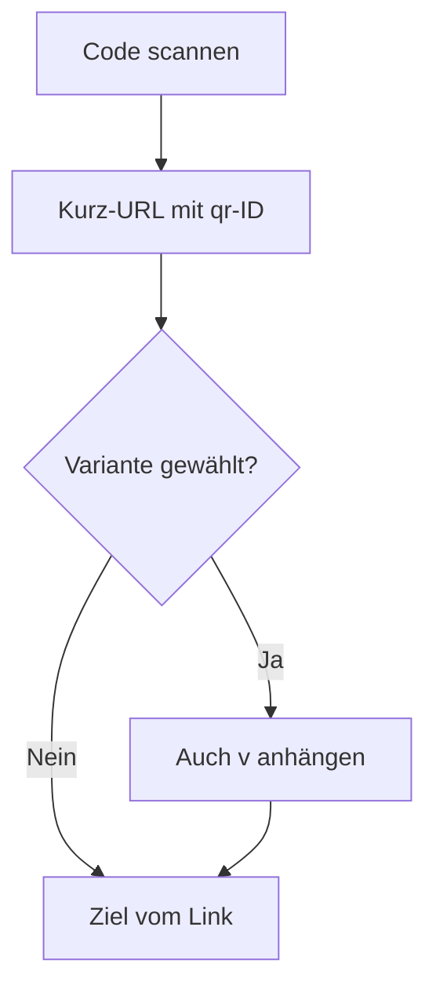

# QR-Codes

QR-Codes kodieren die Kurz-URL plus eine `qr`-ID, deshalb braucht eine Zieländerung keinen neuen Code. Ein Code kann auch eine Kampagnenvariante tragen. Vorschau und Downloads folgen der im Editor gewählten Variante, auch vor dem Speichern. Gespeicherte Codes stehen mit dem neuesten zuerst in einer Tabelle aus Name und URL. Die Auswahl einer Zeile lädt das Mittelbild dieses Codes.

Die kodierte Adresse sieht so aus: `https://share.example.com/s/summer-sale?qr=<qr id>`. Wenn eine Variante gewählt ist, enthält sie auch `v=<variant id>`. Ein Scan wird diesem Code zugeordnet. Eine Varianten-ID oder QR-ID, die zu einem anderen Link gehört, wird ignoriert, und der Besuch nutzt die eigenen UTM-Werte des Links.

## Editor

Öffne einen Link und nutze den Abschnitt QR-Code unter den Linkfeldern. Die Vorschau steht auf einem schmalen Bildschirm über diesen Steuerelementen und auf einem breiten rechts daneben.

| Steuerung | Möglichkeiten |
| --- | --- |
| Name | Bezeichnung in der Liste der gespeicherten Codes |
| Kampagnenvariante | Keine Variante oder eine Variante dieses Links |
| Module | Quadrat, Abgerundet, Punkte, Abgerundete Punkte |
| Finder | Quadrat, Abgerundet, Extra abgerundet, Punkt |
| Vordergrund und Hintergrund | Farben |
| Transparenter Hintergrund | Nur PNG und SVG |
| Größe des Mittelbilds | Wie viel der Mitte das Logo bedeckt |
| Fehlerkorrektur | L, M, Q oder H. H stellt etwa 30 % des Codes wieder her und ist die richtige Wahl, wenn ein Mittelbild einen Teil des Musters bedeckt |
| Ruhezone | Leerer Rand um den Code, in Modulen |

Scan-Hinweise sitzen an der Steuerung, die sie beschreiben: Vordergrundkontrast, Größe des Mittelbilds, Fehlerkorrektur, Ruhezone und transparenter Hintergrund. Sie decken geringen Kontrast, ein großes Mittelbild, fehlende hohe Fehlerkorrektur bei einem Mittelbild, eine zu kleine Ruhezone und einen transparenten Hintergrund ab, der auf einer dunklen Fläche scheitern kann.

## Downloads

Downloads gibt es als PNG, JPEG und SVG. JPEG nutzt immer einen deckenden Hintergrund. JPEG kann keine Transparenz speichern, deshalb wird ein transparentes Design auf die JPEG-Hintergrundfarbe gelegt.

Mittelbilder kommen aus der [Mediathek](/docs/user/media). Aus der Mediathek wählen nimmt eine vorhandene Datei. Eine PNG-, JPEG- oder WebP-Datei, die du auf das Feld ziehst, wird in die Mediathek hochgeladen und ausgewählt. Die Auswahl eines Bildes stellt die Fehlerkorrektur auf H. Ein Bild mit mehr als 1024 Pixeln je Seite wird in Downloads verkleinert. Mittelbild entfernen löst es vom Code, die Datei bleibt in der Mediathek. Solange ein QR-Code eine Datei nutzt, kann sie nicht aus der Mediathek gelöscht werden.

Mittelbilder, die ältere Versionen in `QR_DATA_DIR` gespeichert haben, wandern beim Serverstart in die Mediathek. Jedes erhält den Link-Slug und den Codenamen als Namen, etwa `summer-sale Default QR center image.png`, und gehört dem Linkbesitzer.

Ein heruntergeladenes Bild behält die Adresse, die damals kodiert wurde. Weiterleitungen passen auf den Pfad, deshalb funktioniert ein Host weiter, der diesen Prozess noch erreicht. Eine Änderung des öffentlichen Präfixes oder der Domain schreibt eine schon heruntergeladene Datei nicht um. Schalte alte Präfixe ein oder lade einen neuen Code herunter, wenn diese Adressen weiter aufgelöst werden müssen.
