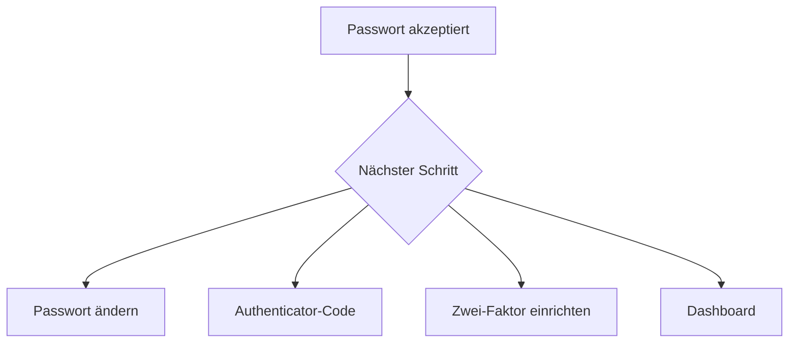

# Anmelden

Die Registrierung ist geschlossen. Eine Administratorin oder ein Administrator legt jedes Konto an und setzt ein vorläufiges Passwort. Bei der ersten Anmeldung wird ein neues Passwort verlangt, bevor das Dashboard aufgeht. Auf dieser Seite füllt Passwort erzeugen ein 16-stelliges Passwort, das du behalten kannst. Eine Administratorin oder ein Administrator kann später für jedes Konto ein neues vorläufiges Passwort setzen, auch für ein anderes Administratorkonto. Damit endet die aktuelle Anmeldung dieser Person. Das Löschen eines Kontos entfernt auch die Links, Kampagnen, QR-Codes und API-Schlüssel dieser Person. Deaktivieren behält das Konto und seine Daten, blockiert aber die Anmeldung.

## So funktioniert die Anmeldung

Melde dich mit einem Benutzernamen oder einer E-Mail-Adresse und dem Passwort an. Groß- und Kleinschreibung werden bei Benutzername und E-Mail ignoriert.

Nach einem richtigen Passwort führt Sharry zum nächsten nötigen Schritt:

- Ein vorläufiges Passwort öffnet die Seite zum Passwort ändern. Das Dashboard bleibt geschlossen, bis das neue Passwort gespeichert ist. Passwort erzeugen baut ein 16-stelliges Passwort aus Buchstaben, Ziffern und Zeichen. Du kannst es anzeigen und kopieren, bevor du weitergehst.
- Wenn die Zwei-Faktor-Authentifizierung schon an ist, fragt die nächste Seite nach einem Authenticator-Code oder einem Wiederherstellungscode.
- Wenn eine Administratorin oder ein Administrator die Zwei-Faktor-Authentifizierung verlangt und dieses Konto noch nicht eingerichtet ist, folgt die Einrichtung.
- Sonst öffnet sich das Dashboard.

Eine Sitzung, die noch einen Passwortwechsel oder einen Einrichtungsschritt braucht, kann den Rest des Dashboards nicht öffnen. Eine andere Adresse führt zurück zu diesem Schritt.

## Rollen

Administratorinnen und Administratoren verwalten alle Benutzer, Links, Kampagnen, QR-Codes, Einstellungen, Audit-Ereignisse und API-Schlüssel. Standardbenutzer verwalten nur ihre eigenen Links, Kampagnen und Analysen, außer die Einstellungen teilen die Links anderer Personen. Diese Prüfungen laufen in der API. Ein Standardbenutzer sieht Benutzer, API-Schlüssel, Einstellungen und Audit nicht.

## Zwei-Faktor-Authentifizierung

Die Zwei-Faktor-Authentifizierung bleibt aus, bis du sie unter Konto einschaltest oder eine Administratorin oder ein Administrator sie in den Einstellungen verlangt. Sie lässt sich erst einschalten, wenn in den Einstellungen ein Mailserver gespeichert ist. Bis dahin bleiben die Konto-Schalter gesperrt, und die Pflicht in den Einstellungen lässt sich nicht einschalten.

Die Einrichtung zeigt einen QR-Code und das Geheimnis, und beides lässt sich kopieren. Bestätige mit einem Code aus der Authenticator-App. Sharry zeigt dann acht Wiederherstellungscodes. Kopiere sie und bewahre sie an einem anderen Ort auf als dem Gerät mit dem Authenticator. Jeder Wiederherstellungscode gilt einmal. Du kannst den Satz unter Konto ersetzen, nachdem du dein Passwort eingegeben hast. Das Ausschalten der Zwei-Faktor-Authentifizierung löscht die ungenutzten Codes. Wenn eine Administratorin oder ein Administrator einen Code verlangt, kannst du sie nicht ausschalten.

Wenn ein Code nötig ist, geht die Anmeldung nach dem Authenticator-Code oder einem Wiederherstellungscode weiter. Diese Abfrage läuft nach fünf Minuten ab.

## Passwort zurücksetzen

Die E-Mail zum Zurücksetzen nutzt den Mailserver aus den Einstellungen. Solange dort kein Host und keine Absenderadresse gespeichert sind, kann Sharry auf die Serverumgebung zurückfallen. Wenn keines von beiden eingerichtet ist, bleibt die Reset-E-Mail aus.

Fordere ein Zurücksetzen mit der E-Mail-Adresse des Kontos an. Der Link ist `{APP_URL}/login/reset?token=...` und läuft nach einer Stunde ab. Eine weitere Reset-E-Mail ersetzt den vorherigen ungenutzten Link. Der Token wird in derselben Datenbanktransaktion als benutzt markiert wie der Passwortwechsel, damit eine wiederholte oder überlappende Anfrage kein zweites Passwort setzen kann.

## Sprache

Jedes Konto wählt seine Sprache unter Konto. Englisch ist die Vorgabe. Deutsch ist ebenfalls verfügbar. Die Wahl wird am Konto gespeichert, deshalb öffnet die nächste Anmeldung in jedem Browser in dieser Sprache. Die Seiten zum Anmelden und zum Zurücksetzen nutzen die Sprache, die dieser Browser zuletzt gespeichert hat. Eine weitere Sprache später ist eine Codeänderung: den Code in die Sprachliste aufnehmen, einen Nachrichtenkatalog anlegen und einen Docs-Ordner hinzufügen. Dafür ist keine neue Datenbankmigration nötig.

## Kontofoto

Konto ist eine Seite mit vier Abschnitten: Profil, Sprache, Passwort und Zwei-Faktor-Authentifizierung. Unter Profil kann ein Foto gespeichert werden. Nutze ein PNG-, JPEG- oder WebP-Bild, höchstens 512 KB. Foto entfernen fragt zuerst nach und löscht dann die Datei. Auch das Ausschalten der Zwei-Faktor-Authentifizierung fragt nach dem Passwort noch einmal nach. Das Foto liegt auf der Festplatte, nicht in PostgreSQL.
