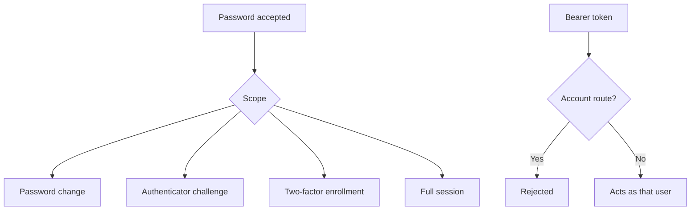

# Auth

Dashboard requests send a session cookie named from `APP_NAME`. The default `Sharry` uses `sharry_session`. The cookie is `HttpOnly`, `SameSite=Lax`, and `Secure` in production. `requireUser` in `apps/api/src/auth.ts` loads that session and rejects accounts that still need a password change or a two-factor step.

The session row stores a hash of the token, not the token. The hash uses `SESSION_SECRET`.

## Session scope

Sign-in creates one of four scopes. The dashboard loaders only allow `full`.

| Scope | When | Lifetime |
| --- | --- | --- |
| `password_change` | `mustChangePassword` is set | 30 minutes |
| `mfa_challenge` | Two-factor authentication is already on | 5 minutes |
| `mfa_enroll` | Settings require a code and this account has not enrolled | 30 minutes |
| `full` | Password accepted and no further step | `sessionTtlHours` from Settings, default 168 hours |

A password-change session that opens the enrollment page goes to the password page, not back to sign-in. Replacing the session deletes the previous token. Logout deletes the current session and clears the cookie.

Passwords are hashed with Argon2id. A missing user still runs a dummy verify so the response time does not reveal whether the account exists.

## API keys

Outside `/api/auth`, a request may instead send `Authorization: Bearer`. `actorFromApiKey` in `apps/api/src/api-keys.ts` hashes the secret with `SESSION_SECRET` and loads the bound user as a full session. The plaintext is not stored. Revoked keys, inactive users, and users who must change their password are rejected. When Settings require two-factor authentication, a key works only after that user has enrolled. The same secret starts working again once enrollment is finished, or when the requirement is turned off. The key does not send an authenticator code. Creating a key for a user who has not enrolled is refused while that setting is on.

`requireAdmin` is the same check plus the admin role. Link, campaign, QR, and analytics queries keep using that actor, so a standard user’s key cannot read another user’s rows.

API key requests are limited to about 120 per minute per key. Account routes ignore keys and keep their own stricter limits. Sign-in, password change, password reset, authenticator setup, the two-factor challenge, authenticator confirmation, turning two-factor authentication off, and recovery-code replacement are each limited to 10 attempts per minute. A forgotten-password address is mailed at most 5 times an hour. Further requests for that address still return `{ ok: true }` and send nothing, including when the address has no account.

Changing the password, or turning two-factor authentication on or off, deletes every other session for that account. The browser that made the change stays signed in. Signing in on another device does not end existing sessions. API keys are not sessions.

## Recovery and reset

A new password-reset email replaces any unused link for that account. The reset token expires after one hour. It is marked used in the same database transaction as the password change, so a repeated or overlapping request cannot apply a second password.

Confirming an authenticator enrollment returns eight recovery codes. A recovery code is marked used in one update, so it cannot be accepted twice. Replacing the set, or turning two-factor authentication off, deletes the previous codes. The authenticator secret is encrypted with `ENCRYPTION_KEY` before it is stored.

Expired and used reset tokens are deleted on startup and then hourly, together with expired sessions.

Two-factor setup is refused until Settings has a saved mail server (`smtpSource` is `app`). The environment fallback is not enough to enroll. When `mfaRequired` is on, an account cannot disable two-factor authentication.
