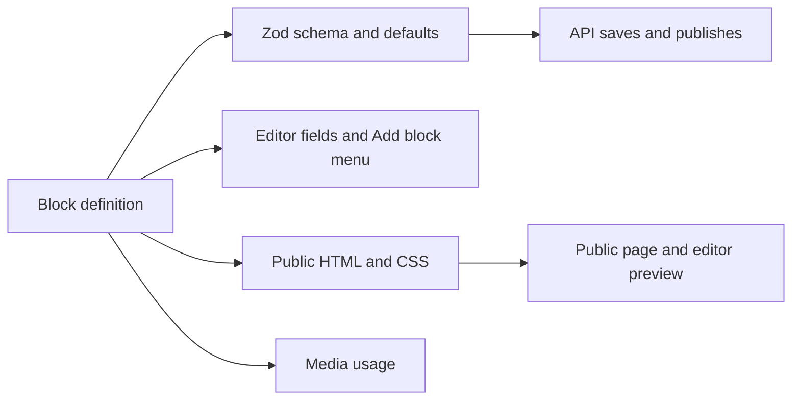

# Page builder blocks

Every component in the page builder is one block definition in `packages/shared/src/pages/blocks`. The definition is the single source for everything about the block. Nothing else in the API or the editor is written per block.



- `fields` become the Zod schema the API validates with (`propsSchema`), the defaults of a new block (`defaultProps`), and the controls in the editor inspector (`FieldsEditor` in `apps/web/src/components/page-builder/field-editor.tsx`).
- `slots` are the areas that hold other blocks. The block tree shows them, and they accept drops and Add block.
- `label`, `description`, `icon`, and `group` place the block in the Add block dialog. The order of `pageBlocks` in `registry.ts` is the order in that dialog.
- `css` and `render` produce the HTML. The public page, the signed-in preview, and the live preview in the editor all call the same `renderPage`.
- `media` fields are collected by `pageMediaIds`, so the files count as used in the media library and the API checks that the author may use them.

## Page structure

A page stores `{ blocks: PageBlock[] }` as JSON in `landing_pages.content`, and the published copy in `published_content`.

```ts
type PageBlock = {
  id: string // 1 to 40 letters, digits, _ or -, unique within the page
  type: string // the definition's type
  props: Record<string, unknown> // one value per field
  slots?: Record<string, PageBlock[]> // one list per slot
}
```

A page holds at most `PAGE_MAX_BLOCKS` (300) blocks and `PAGE_MAX_DEPTH` (4) levels. Settings that belong to the whole page, such as the title, background, font, and share image, live in `pageSettingsSchema`, not in a block.

## Add a block

The example adds a Notice block: a short highlighted message.

### 1. Write the definition

Create `packages/shared/src/pages/blocks/notice.ts`:

```ts
import { defineBlock } from '../block.ts'
import { field } from '../fields.ts'
import { escapeHtml } from '../html.ts'
import { color, pick, radius, radiusOptions, styleAttr } from '../style.ts'

export const noticeBlock = defineBlock({
  type: 'notice',
  label: 'Notice',
  description: 'A short highlighted message.',
  icon: 'Info',
  group: 'Content',
  fields: {
    text: field.text({ label: 'Message', max: 300, multiline: true, default: 'Doors open at 9.' }),
    background: field.color({ label: 'Background', default: '#fef3c7' }),
    radius: field.choice({ label: 'Corners', default: 'md', options: radiusOptions }),
  },
  css: '.b-notice{margin:0;padding:12px 16px;white-space:pre-line}',
  render(props) {
    const style = styleAttr({ background: color(props.background), 'border-radius': pick(radius, props.radius, 'md') })
    return `<p class="b-notice"${style}>${escapeHtml(props.text)}</p>`
  },
})
```

`defineBlock` infers the type of `props` from `fields`, so `render` is type checked against them.

Strings in a definition stay in English. The editor translates them with `t()`.

- `type` is stored in every saved page. Use lowercase letters, digits, and hyphens, and never rename it once pages use it.
- `group` is `Layout`, `Content`, or `Media`.
- Each field needs a `label` and a `default`. A `choice` default must be one of its options.

### 2. Register it

Add `noticeBlock` to `pageBlocks` in `packages/shared/src/pages/registry.ts`, at the position it should have in the Add block dialog.

### 3. Give it an icon

The icon is a [lucide](https://lucide.dev/icons) name. A new name goes in two places:

1. `blockIconNames` in `packages/shared/src/pages/block.ts`.
2. The `blockIcons` map in `apps/web/src/components/page-builder/block-icons.tsx`, imported from `lucide-react`.

The map is typed `Record<BlockIconName, LucideIcon>`, so `npm run typecheck` fails until both lists match. Reusing an existing icon needs no change.

### 4. Translate it

Add a German entry to `apps/web/src/i18n/de.ts` for every string the block shows that is not there yet: `label`, `description`, slot labels, field labels, `help` texts, choice option labels, and a list's `itemLabel`. In the example these are `Notice`, `A short highlighted message.`, and `Message`. `Background`, `Corners`, and the corner options already exist.

### 5. Run the tests

`npm test` runs the contract in `packages/shared/src/pages/blocks.test.ts` for every registered block, so a new block is tested without writing a test:

- It has a label, description, known icon, and group, each field has a label, and each choice default is an option.
- The defaults pass the block's own schema, and an empty `props` object fills in the defaults.
- A new block created with `createBlock` validates and renders.
- Blocks placed in each slot appear in the HTML.
- A hostile string in every text field is escaped.
- Every CSS class starts with `b-`.
- Every `type` is unique and lowercase.

`apps/web/src/components/page-builder/blocks.test.ts` checks that every block has an icon in the editor and a German string for each label, description, and option.

Add a test to `packages/shared/src/pages/page.test.ts` for behavior specific to the block, such as a choice that changes the markup.

No database migration, API route, or editor change is needed. Run `npm run typecheck` and `npm test`, then document the block in `apps/web/docs/<locale>/user/pages.md`.

## Field kinds

Create fields with the `field` helpers in `packages/shared/src/pages/fields.ts`.

| Helper | Stored value | Validation | Editor control |
| --- | --- | --- | --- |
| `field.text({ max, multiline?, placeholder? })` | string | Trimmed, at most `max` characters | Input, or a text area when `multiline` |
| `field.richText()` | HTML string | At most 20,000 characters, cleaned by `cleanRichText` | TipTap editor with a formatting toolbar |
| `field.url({ shortLinks?, placeholder? })` | string | `isSafeHref`: `http(s)`, `mailto:`, `tel:`, `/path`, `#anchor`, or empty | Input. `shortLinks` suggests the user's short links |
| `field.color()` | `#rrggbb` or `null` | Six-digit hex | Color picker and hex input with a clear button. Handle `null` in `render` |
| `field.choice({ options, default })` | One option value | Must be a listed value | Select |
| `field.toggle()` | boolean | Boolean | Switch |
| `field.media({ accept: 'image' \| 'video' })` | Media library id or `null` | UUID. The API checks the author may use the file | Media field with library picker and drop to upload |
| `field.list({ item, itemLabel, min?, max })` | Array of item props | Between `min` and `max` items, each item validated by its fields | Repeating group with add, remove, and reorder |

Every helper accepts `help`. Text, URL, and choice fields show it in an info tooltip beside the label. A list item holds scalar fields only, not other lists. `style.ts` has the shared scales: `spacingOptions`, `radiusOptions`, `fontOptions`, `alignOptions`, and `textSizeOptions`, with `pick` to look up their CSS values. Use them instead of free numbers so pages stay consistent.

A new field kind needs a case in `fieldSchema` in `fields.ts` and in `FieldControl` in `field-editor.tsx`, plus tests in `field-editor.test.tsx` and `page.test.ts`.

## Slots

A block with `slots: [{ name: 'children', label: 'Content' }]` receives the rendered HTML of each slot in the third `render` argument. Place it as is, for example `${slots.children ?? ''}`. The HTML is already escaped and rendered by the child blocks. Nesting stops at `PAGE_MAX_DEPTH`, and the editor refuses a drop or addition that would go deeper.

`container` and `columns` are listed in `layoutBlocks` in `render.ts`. At the top level of a page those blocks span the full width, while other blocks are grouped in a centered column with page margins. Add a new full-width section block to that set.

## Rendering rules

Public pages are served with a Content Security Policy that blocks scripts, frames, forms, and outside resources. Keep `render` within those limits:

- Escape every text value with `escapeHtml`, including attribute values.
- Build `style` attributes with `styleAttr`. It skips empty values and escapes the result. Pass colors through `color()` and scale keys through `pick()`, because a stored value may come from an older version of the block. `rgba()` turns a stored color and an opacity into an `rgba()` value, and `cssUrl()` wraps a media path for `background-image` with quotes, parentheses, and spaces encoded.
- Build an `id` from user text with `anchorId()`, which keeps lowercase letters, digits, and hyphens.
- Share markup between blocks with an exported helper, as `buttonHtml()` and `buttonCss` in `button.ts` do for Button and Button group. A block's CSS is only added to pages that use that block, so a block that reuses another block's classes must include that CSS too.
- Pass rich text through `cleanRichText` again before output.
- Check links with `isSafeHref` before writing an `href`.
- Resolve media with `context.media(id)`. It returns `null` for a missing or deleted file, and the block should then render nothing or a fallback.
- Do not write `<script>`, inline event handlers, or `<iframe>`. Interactive blocks use HTML only, as the accordion does with `<details>` and `<summary>`. Icons are drawn in CSS, which is why the accordion offers an arrow or a plus marker instead of an icon picker.
- Write `css` once per block and prefix every class with `b-<type>`. The CSS is inlined only on pages that use the block. A modifier class such as `.bordered` may follow a `b-` class in the same selector. The CSS test lists the allowed modifiers.

## Change a block later

Saved pages are parsed with the current definitions, so a change has to accept what older pages stored:

- A new field takes its `default` on existing blocks. This is safe.
- A removed field is dropped the next time the page is saved. This is safe.
- Do not remove a choice option that saved pages may use. Their drafts would fail validation on save and in the signed-in preview. Keep the old value as an option and map it in `render`, for example with `pick` and a fallback.
- Do not rename or remove a block `type`. Published pages skip an unknown block, but drafts that contain it can no longer be saved or previewed.
