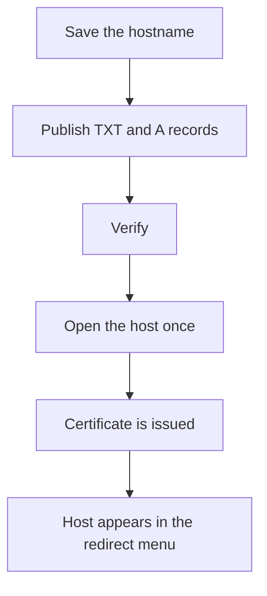

# Domains

Domains is available to administrators. A redirect domain is a hostname people can choose when they create or edit a link, so the short URL can use that host instead of the deployment domain. The deployment domain stays the default and is not added here.

## Add a domain

Enter a hostname such as `go.brand.com`. The name has no scheme, port, or path. Saving opens a dialog with the two DNS records.

1. Add a TXT record. The dialog shows the name and the token. The name is `_<slug>-challenge.go.brand.com`, where the slug comes from `APP_NAME`. The default `Sharry` uses `_sharry-challenge.go.brand.com`. Copy sits next to each value.
2. Add an A record for that hostname pointing at the IPv4 address in the dialog. That address is this server's public IPv4 address. Copy sits next to the address.

If this server has no public IPv4 address, the dialog says the address could not be looked up.

Verify checks the TXT record. Publish both records, then click Verify on the row. After it is verified, open `https://go.brand.com` once so the certificate can be issued. The first visit can be slow while the certificate is requested. Sharry checks the TXT record again every hour. A temporary lookup failure leaves the domain verified. Two checks in a row with no matching record move it back to pending.

A pending row can open the same dialog again with Setup. A taken hostname returns: "That domain is already added."

## After verification

Every signed-in person sees verified domains in the redirect domain menu on New link and on the link editor. Pending domains stay off that menu.

Delete removes the domain. Links that used it show the deployment domain the next time they are read. A certificate that was already issued keeps working until it expires. Printed QR codes keep the host they were created with.
