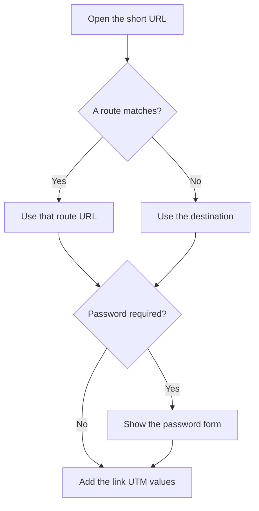

# Links

A short link keeps its slug when you change the destination, so printed QR codes and saved addresses keep working. Slugs are unique without regard to case. A taken slug returns: "This short URL is already in use. Please choose a different slug."

## The public address

The public path uses the prefix stored in Settings, for example `https://share.example.com/s/summer-sale`. Changing the prefix updates every displayed link. Enable legacy prefixes to keep resolving the previous path. That change asks for confirmation.

The domain in that address comes from the deployment origin unless the link stores a verified redirect domain. New link and the link editor both offer that choice. The deployment domain stays the default. A domain that is later removed drops out of the short URL, the CSV export, and new QR codes. A QR image that was already downloaded keeps the address that was encoded at the time. The same slug still opens on the deployment host.

The prefix is a single path segment. It must start with `/` and may contain only lowercase letters, digits, and hyphens. It cannot be a dashboard path such as `api`, `docs`, `login`, or `links`. A slug is 2 to 64 characters of letters, digits, and hyphens, and it cannot be a reserved name such as `favicon.ico` or `robots.txt`.

Leave the slug blank to generate one. The length comes from Settings and is between 4 and 16 characters. The default length is 5. The alphabet leaves out characters that are easy to confuse.

## The links list

The links page loads 50 at a time. Load more shows the rest. Filter a column to match the slug, title, or destination. Each row shows the click total. Text longer than the cell ends in an ellipsis. On a narrow screen the table scrolls sideways so the columns stay readable. Status is Active or Paused. The test icon opens the short URL in a new tab.

Folders are rows in the same list. Create folder, next to New link, adds a folder named New folder and selects that name so you can rename it in the row. Open a folder with one click. Drag a link or folder onto a folder row to move it in, or onto Root or an earlier breadcrumb to move it out. Each row has icon actions for move, open, and delete, and a right-click menu for move and delete. On a phone or tablet, hold a finger on the row to open that menu. Move to opens a dialog with the folder tree. Cancel closes it and leaves the row where it is. Deleting a link from the list asks you to type delete in a dialog, the same as on the link page. Checkboxes delete several rows at once. Deleting a folder asks for confirmation and moves its contents up one level. A view-only link cannot be dragged. Column filters and sort replace the old search box, and the header stays visible when a filter matches nothing. Drag the edge of a column header to resize it. That width is remembered in this browser.

Each link, folder, and campaign can use an icon from a fixed set. On a saved link the icon sits beside the heading, and the short URL is on the next line. Link tags and campaign tags are separate, so the same name can exist once for each. A name already on this link or campaign is kept out with “This tag is already in use.” Type a tag and click away to keep it in the field; Save stores it on the link. Each tag gets a color, and you can change that color from the badge. Tags are badges inside the field and in the list. A tag badge in the list filters the open folder.

You see your own links. An administrator sees and edits every link. Settings can let users see each other’s links, view or edit them, and optionally see or change links owned by administrators. When the list includes a link you can view but not change, each row is marked Editable or View only. A view-only title is quieter than an editable one. A link you can open shows who created it and who last changed it. The links list adds Created by when it can include someone else’s link. Last changed by is Unknown when Sharry does not know who saved it.

## Creating and editing

The destination sits above the short-link group. The redirect domain and slug share that group. The page title is the link title: edit the heading, with a larger icon centered beside it. New link uses that same heading and the same order, with no separate title field. On a saved link, the short URL sits under that row, and save, copy, and delete sit on the next row. Folder choices show the root and every folder as a tree. Redirect type, status, expiry, and password are in Settings. The title bar scrolls with the page.

A new link needs an `http` or `https` destination, up to 4096 characters. Title and description are optional. Choose a redirect type or leave the account default from Settings. The default for a new install is 302. The other choices are 301, 307, and 308.

When AI is turned on in Settings, a sparkle beside the title on a new link and on a saved link suggests the page title, and the slug field suggests a free slug. Each one reads the destination page once that destination is a valid URL. A suggested slug is the first three words of that title, or of the address when the title does not make a slug. A tooltip says where the suggestion came from. If Sharry cannot suggest a value, that message stays in the same tooltip. You can change either suggestion. Nothing is stored until you save the link. The sparkles stay hidden when AI is off.

The same switch shows Suggest UTM above the UTM fields on a new link, a saved link, and the short-link form in Chat. An optional line says where you will share the link, such as “October newsletter” or “Instagram bio”. Suggest UTM fills source, medium, and campaign. The other UTM fields stay as they are. Nothing is stored until you save.

On the links list, Add several opens a dialog. The list underneath does not move. The dialog accepts up to 20 destination URLs, one per line. Review shows a title and a free slug for each page. A title that is missing or is only the site name is rewritten. Uncheck a row to leave it out. Create links stores the rows you keep, then closes the dialog and clears it. Closing the dialog without creating clears it too.

Expiry is entered in your local time and stored in UTC. A blank expiry never expires. An expired link stops redirecting.

Pause sets the status to disabled. A paused link does not redirect. Switch it back to Active to restore the same slug and click history.

A link can require a password before it redirects. Visitors must enter this password before the short link redirects. The password is stored as a hash. Leave the field blank on a later edit to keep the saved password. Clearing it removes the requirement.

Save, Copy, and Delete sit under the link title. On a small screen those three buttons move into the bar under the top bar. Save link at the end of the form stores the same destination, slug, title, description, redirect domain, redirect type, expiry, password, UTM fields, and routes. The QR code has its own save.

## Routes

Routes are optional. Leave the list empty and every visit uses the destination.

When AI is on, the draft field and Add route sit on one row. The field accepts one sentence, such as “iPhone visitors go to https://apps.example.com, Germany goes to https://example.com/de”. Draft routes adds those rules to the list. You can edit or remove them. They are stored only when you save the link.

Add a route to send some visits to a different `http` or `https` URL. Each route can have as many conditions as you need, and every condition on that route has to match. Routes run from top to bottom. The first matching route is used. Move a route up or down to change which one is checked first. A route can have a name. Leave it empty and the route is shown as Route 1, Route 2, and so on.

Choose one or more values from the list: browser, device, operating system, country, referrer, and UTM source, medium, campaign, id, term, and content. **is** matches when the visit is any of the chosen values. **is not** matches when it is none of them. Search narrows the list. Campaign, id, term, and content also offer values already saved on the link, on its variants, and on its clicks. Referrer and every UTM field can include several custom values beside the presets. A custom referrer matches that host and its subdomains, the same way Google matches `news.google.com`. Country choices need the geo database; without it, a country route is skipped.

UTM conditions read the query string on the short link, for example `?utm_source=newsletter`. The UTM values stored on the link are still added to whichever URL is chosen.

If nothing matches, a saved value is no longer recognized, the route URL is not valid, or the country cannot be looked up, that route is skipped. Visitors then use a later matching route, or the destination. The link page keeps an outdated value and says that visitors use the destination until you update the route. The redirect itself still succeeds.

## Redirects

Sharry sends `Cache-Control: no-store` on every redirect, so a later destination change is used the next time someone opens the short URL. That includes 301 and 308.

A correct password continues with 303, which makes the browser request the destination with GET. That unlock is counted as a click. Later visits use the link's redirect type and an unlock cookie, so the password form is not shown again on that browser until the cookie is gone.

## UTM parameters

Each link can store `utm_source`, `utm_medium`, `utm_campaign`, `utm_id`, `utm_term`, and `utm_content`. Those values are added to the destination at redirect time. Existing unrelated query parameters and the URL fragment are kept.

A blank field adds nothing for that key. If the destination already has the same UTM key, saving warns that the stored value will replace it: "Saving will replace … already present on the destination." The tracked URL under the form is the destination with the current UTM values applied, so you can check the result before you save.

A campaign variant or a QR code can override these values for one visit. See Campaigns and QR codes.
