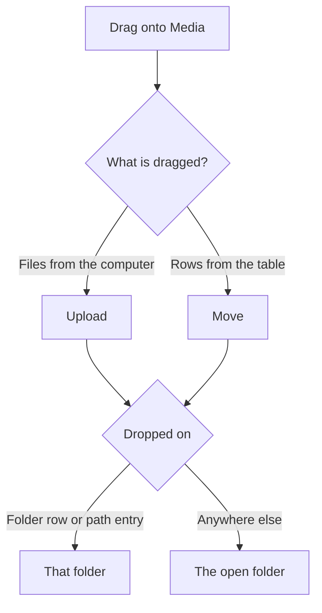

# Media

The media library holds the files the app uses, such as QR code center images. Account photos are the only files that stay outside it. Open Media in the sidebar. Files and folders share one table with the same rows, selection, sorting, filters, and column settings as links and campaigns.

## Upload by dragging

Drag files from your computer anywhere onto the Media page. A frame shows which folder receives them. Drop them on a folder row or on a folder name in the path above the table to upload straight into that folder. Upload and Choose files open the file dialog instead.

Each file shows as a row with a progress bar while it uploads, at most three at a time. A file that is refused stays as a row with the reason until you dismiss it. Accepted types are JPEG, PNG, WebP, GIF, SVG, MP4, WebM, and PDF. The type is read from the file contents, not the name. The size limit is `MEDIA_MAX_UPLOAD_MB`, 25 MB by default.

An SVG that contains scripts, event handlers, embedded HTML, or links to other files is refused. Export it again without them, or convert it to PNG.

Large photos are made smaller on upload. A JPEG, PNG, or WebP wider than 1920 or taller than 1080 pixels is scaled down to fit, keeping its proportions. A portrait image uses the box turned upright, so it can be up to 1080 wide and 1920 tall. A 4000 × 3000 photo becomes 1440 × 1080. A 4000 × 5000 photo becomes 1080 × 1350. JPEG and WebP are saved again at quality 82, which looks the same on screen at a fraction of the size. PNG stays lossless with stronger compression, so transparency and sharp edges are kept. A small image that is already compressed is kept as uploaded.

Saving a photo again also turns it the way the camera held it and removes camera data such as the GPS position. GIF, SVG, videos, and PDFs are stored unchanged.

A name that already exists in the folder gets a number, such as `photo (2).jpg`.

## Organize

Drag a file row onto a folder row to move it in. Drag it onto a name in the path to move it out. When several rows are selected, dragging one of them moves the whole selection. A notice confirms the move and offers Undo for a few seconds. Move to opens the folder tree in a dialog. Create folder adds a folder and lets you name it in place. Deleting a folder moves its files and subfolders up one level.

Search in the table filters by name. Search from the top bar finds files in every folder by name, alt text, or title, and opens the file.

## File details

Choose a row to open the file on the right. You can rename it, write alt text and a title, copy the public URL, and see which QR codes use it. The extension never changes on rename. Alt text describes the image for people who cannot see it. The Alt text filter lists images that still lack it.

A file that is in use cannot be deleted. Remove it from the QR codes listed under Used by first.

## Public URLs and privacy

Every file has a public address of the form `https://share.example.com/files/<id>/<name>`. Anyone with the address can open it, also on a verified redirect domain, so do not upload private documents. The random id makes the address hard to guess. Videos support seeking.

Who sees which files follows the link sharing settings in [Settings](/docs/user/settings). You see your own files. An administrator sees every file. “Users see each other's links” also shows other people’s files, and “Users can edit each other's links” lets you change them. A file you can see but not change is shown in a muted color and has no move or delete actions.

## QR codes

The Center image field in the QR code editor uses the library. Choose from library opens a picker with folders and search. Dropping a file onto the field or into the picker uploads it to the library and selects it. Only PNG, JPEG, and WebP can be a center image. See [QR codes](/docs/user/qr-codes).
