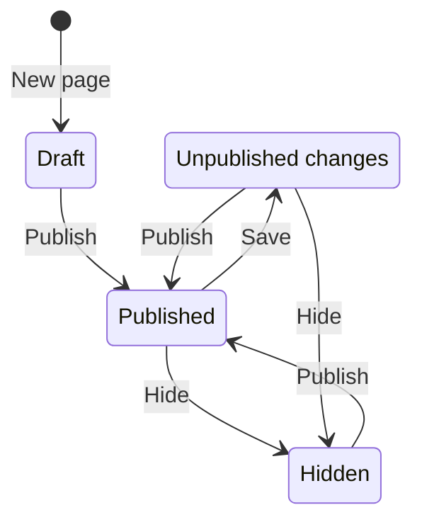

# Pages

Pages are landing pages you build from blocks, such as headings, text, buttons, images, and accordions. Open Pages in the sidebar. Pages and folders share one table with the same rows, selection, sorting, filters, column settings, and drag and drop as links and media.

A page is public at `https://share.example.com/l/<slug>`. An administrator can change the `/l` prefix in [Settings](/docs/user/settings). Short links and pages always use different prefixes.

## Create a page

Choose New page, enter a title, and keep or change the suggested slug. The suggested slug is built from the first three words of the title, for example `Winter market` becomes `winter-market`, and gets `-2` when it is already taken. Leave it blank for a random slug. Slugs use the same rules as short link slugs: 2 to 64 letters, digits, and hyphens. Two pages cannot share a slug, whatever the capitalization.

A new page starts hidden, with one section that holds the title, a sentence, and a button. Nobody outside the app can see it until you publish it. A page created inside an open folder is placed in that folder.

## The editor

The editor has the block list and the settings of the chosen block on the left, and a live preview on the right. On a narrow screen the preview moves below.

- **Blocks** lists the page from top to bottom. Blocks that hold other blocks, such as Container and Two columns, show their content indented below them.
- Choose a block to edit it. Its fields appear under the list.
- **Add block** at the end of the list adds to the page. The button inside a container or a column adds to that area.
- Drag a block by its handle onto another block to place it before that block, or onto an Add block button to place it at the end of that area. Move up and Move down do the same with the keyboard or mouse.
- Duplicate copies a block with everything inside it. Delete removes it.
- The preview switches between desktop and mobile width. It is drawn by the same code as the public page, so what you see is what visitors get. Links in the preview do not open.

A page can hold up to 300 blocks, nested up to 4 levels deep. A move or an addition that would break these limits is refused with a message.

### Blocks

| Block | Use it for | Notable settings |
| --- | --- | --- |
| Container | A section that groups other blocks | Content width, minimum height, vertical position, horizontal alignment, space above and below, space at the sides, outer space, corners, background, text color, border, shadow, background image with overlay, anchor |
| Two columns | Two areas side by side. They stack on a phone | Column widths, gap, vertical alignment, inner space, background, text color |
| Heading | A title. Use one Heading 1 per page | Level 1 to 3, alignment, font, color |
| Text | Formatted text | Bold, italic, underline, strikethrough, subheadings, lists, quotes, links, text alignment, size, font, color |
| Button | A call to action | Label, link, tooltip, new tab, filled or outline, colors, corners, size, font, width, padding, alignment |
| Button group | Up to four buttons side by side, such as a main and a second call to action | Per button: label, link, filled or outline, new tab. For the group: colors, corners, text size, gap, alignment, stack on phones |
| Feature grid | Up to 12 cards in two, three, or four columns. Phones show one column | Per card: image, title, formatted text. For the grid: columns, small icon or full-width image, plain, bordered, or filled cards, card color, corners, gap, alignment |
| Image | An image from the media library | Alt text, caption, link, width, alignment, corners, border, space, filter |
| Video | An MP4 or WebM video from the media library | Cover image, controls, play muted on a loop, corners |
| Image gallery | Up to 24 images from the media library in a grid. Phones show two columns | Per image: file, alt text, caption. For the gallery: columns, shape (original, square, 4:3, 16:9), gap, corners, show captions, open full image on click |
| Accordion | Questions or sections that open on click | Items with a headline and formatted answer, arrow or plus marker, open the first item, corners, colors, lines |
| Quote | A quote or testimonial | Source, plain, line at the side, or large style, alignment, font, color |
| Spacer | Empty space between blocks | Height |
| Divider | A horizontal line | Solid, dashed, or dotted, width, space around, color |

The Link field of a button suggests your short links while you type, so a button can send visitors through a tracked short link. A link may be a web address, `mailto:`, `tel:`, a path that starts with `/`, or an anchor such as `#prices`. Other addresses are refused.

The Link button in the text toolbar opens a small dialog for the address. An address that is not allowed is marked at the field and the dialog stays open. On an existing link, Remove link takes the link off and keeps the text.

Text formatting is limited to what the public page can show safely. Pasted content keeps bold, italic, underline, strikethrough, inline code, links, lists, subheadings, quotes, and text alignment. Everything else, such as colors, fonts, and embedded content, is removed.

Image alt text comes from the media library. Fill in Alt text on the block to use a different text on this page. Choosing or dropping a file in an Image, Video, Image gallery, or Feature grid block, or as a container background, adds it to the media library. See [Media](/docs/user/media).

A container's minimum height makes a section taller than its content, up to the full screen for a hero section. Vertical position then places the content at the top, center, or bottom, or spreads the blocks out. Horizontal alignment keeps blocks at full width (Stretch) or lets them keep their own width on the left, center, or right.

A background image covers the whole section and is cropped to fit. Overlay lays a color over it, Light, Medium, or Strong, so text on top stays readable. Set the text color of the container to match.

Anchor gives a container a name, such as `prices`. A button or link with the address `#prices` then scrolls to that section. The name is stored in lowercase with letters, digits, and hyphens only. Use each name once per page.

Accordions open and close without JavaScript. Each item has a headline and a formatted answer, and the marker is an arrow or a plus.

## Save and publish

**Save** stores the draft. Visitors still see the last published version. **Publish** saves the draft and makes it the public page in one step. Cmd+S or Ctrl+S saves. An Unsaved badge appears next to the title while there are changes that are not saved. Leaving the editor or closing the tab with unsaved changes asks first.

| Status | Meaning |
| --- | --- |
| Draft | Never published. Visitors get “not found”. |
| Published | Visitors see exactly the saved version. |
| Unpublished changes | Visitors see the last published version. The saved draft differs from it. |
| Hidden | Visitors get “not found”. The published version is kept for the next publish. |

**Hide from visitors** in the editor header takes a published page offline right away. The same switch in Page settings is saved with the next Save. Publishing always turns it off.

## Preview a page that is not public

While you are signed in, opening the page address shows the saved draft of a page that is a draft, hidden, or has unpublished changes, with a “Preview, not public” bar at the top. Other visitors get “not found”. The Preview button opens the same draft view. It shows the last saved version, so save first to see your latest edits. The preview is never cached or indexed by search engines. On a redirect domain only the published version is served.

## Page settings

Settings in the editor header opens the page settings. They are saved and published together with the blocks.

- **Title** is the browser tab title. **Slug** changes the address. Changing the slug of a published page breaks the old address.
- **Folder** and **Redirect domain** work like they do for links. A page with a redirect domain is served on that domain and on the main address. It is not served on any other redirect domain.
- **Hide from visitors** is described above.
- **Search engines**: Description is used in search results. Hide from search engines adds `noindex, nofollow`. Language sets the page language, such as `en` or `de-AT`.
- **Social sharing**: Share title, share description, and share image are used when the address is posted in chats and social networks. Blank fields fall back to the title and description.
- **Look**: Background, text color, and the page font. Blocks set to Page font use it.

## Find, organize, and share

The table shows each page with its status, address, owner, and last change. Filter by title or status, and sort by title, address, or last change. Copy URL copies the public address. View live opens it once the page is published. Click a row to check it, and click it again to open the page or folder. Shift-click checks the rows in between, and Cmd-click checks single rows. Checked rows are light blue. Delete and Move to act on the selection. Dragging one checked row onto a folder moves the whole selection. Deleting a folder moves its pages up one level. Search from the top bar finds pages by title, slug, or description.

Who sees and changes which pages follows the link sharing settings in [Settings](/docs/user/settings), the same as for links and media. A page you can see but not change opens read-only. Duplicate creates a hidden copy of the last saved version that you own.

Deleting a page makes its address return “not found” right away. It cannot be undone.

## Safety

Public pages never run scripts. They load images and videos only from this app and use a strict Content Security Policy. Text and settings are checked on the server, so a page cannot be changed to include scripts, frames, or forms through the API either.
