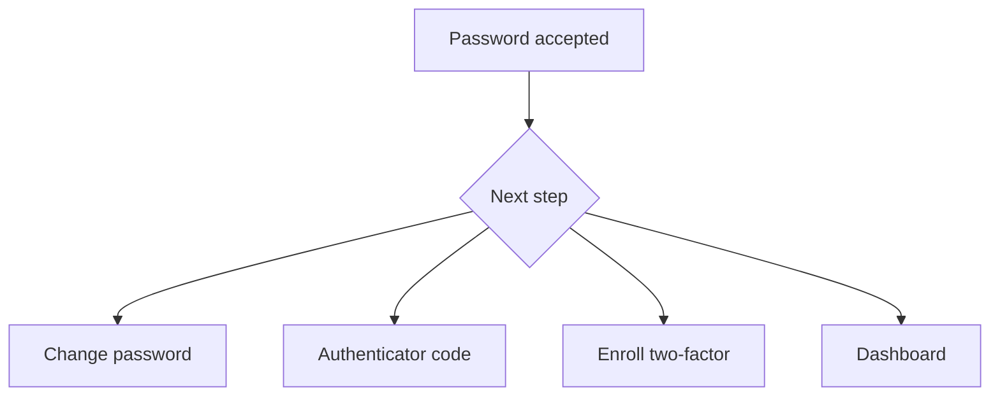

# Signing in

Registration is closed. An administrator creates each account and sets a temporary password. The first sign-in asks for a new password before the dashboard opens. On that page, Generate password fills a 16-character password you can keep. An administrator can later set a new temporary password for any account, including another administrator. That ends the person's current sign-in. Deleting an account also removes that person's links, campaigns, QR codes, and API keys. Deactivate keeps the account and its data, but blocks sign-in.

## How sign-in works

Sign in with a username or an email address, plus the password. The match ignores letter case for both the username and the email.

After a correct password, Sharry sends you to the next required step:

- A temporary password opens the change-password page. The dashboard stays closed until the new password is saved. Generate password builds a 16-character password with letters, digits, and symbols. You can show it and copy it before you continue.
- If two-factor authentication is already on, the next page asks for an authenticator code or a recovery code.
- If an administrator requires two-factor authentication and this account has not enrolled, the next page is enrollment.
- Otherwise the dashboard opens.

A session that still needs a password change or an enrollment step cannot open the rest of the dashboard. Opening another address sends you back to that step.

## Roles

Administrators manage every user, link, campaign, QR code, setting, audit event, and API key. Standard users manage only their own links, campaigns, and analytics, unless Settings shares other people's links. Those checks run in the API. A standard user does not see Users, API keys, Settings, or Audit.

## Two-factor authentication

Two-factor authentication stays off until you turn it on from Account, or an administrator requires it in Settings. It cannot be turned on until an administrator has saved a mail server in Settings. Until then, the Account controls stay unavailable and the Settings requirement cannot be switched on.

Setup shows a QR code and the secret, and both can be copied. Confirm with a code from the authenticator app. Sharry then shows eight recovery codes. Copy them and store them somewhere that is not the same device as the authenticator. Each recovery code works once. You can replace the set from Account after entering your password. Turning two-factor authentication off deletes the unused codes. When an administrator requires a code, you cannot turn it off.

When a code is required, sign-in continues after the authenticator code or a recovery code. That challenge expires after five minutes.

## Password reset

Password reset email uses the mail server saved in Settings. Until a host and from address are saved there, Sharry can fall back to the server environment. If neither is configured, reset email stays off.

Ask for a reset with the account email. The link is `{APP_URL}/login/reset?token=...` and expires after one hour. Asking for another reset email replaces the previous unused link. The token is marked used in the same database transaction as the password change, so a repeated or overlapping request cannot apply a second password.

## Language

Each account chooses its own language on Account. English is the default. German is available too. The choice is saved on the account, so the next sign-in on any browser opens in that language. The sign-in and reset pages use the language this browser last saved. Adding another language later is a code change: add its code to the locale list, add a message catalog, and add a docs folder. It does not need a new database migration.

## Account photo

Account is one page with four sections: Profile, Language, Password, and Two-factor authentication. Profile can store a photo. Use a PNG, JPEG, or WebP image, 512 KB or smaller. Remove photo asks first, then deletes the file. Turning two-factor authentication off also asks for a confirmation after the password. The photo is stored on disk, not in PostgreSQL.
